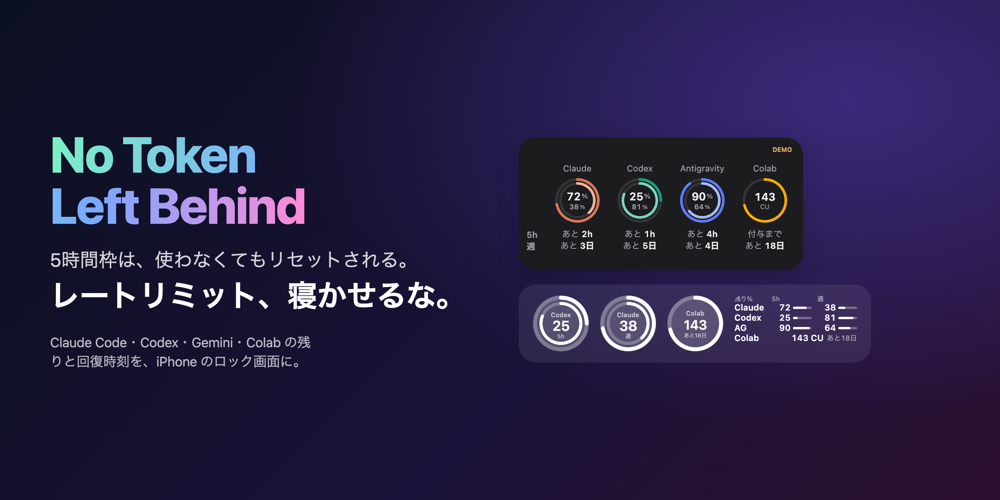
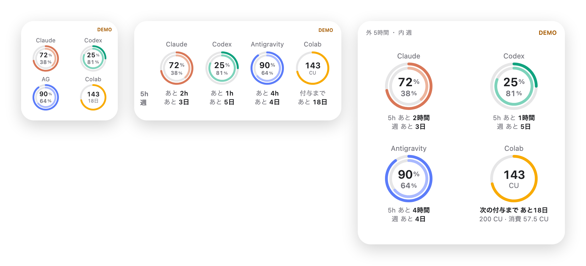
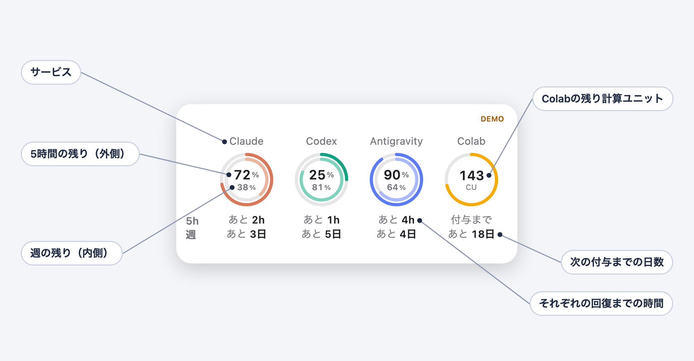
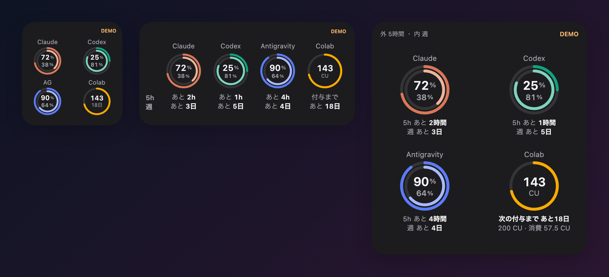
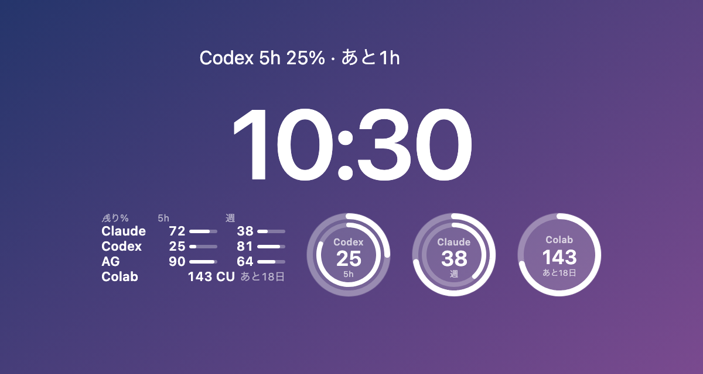
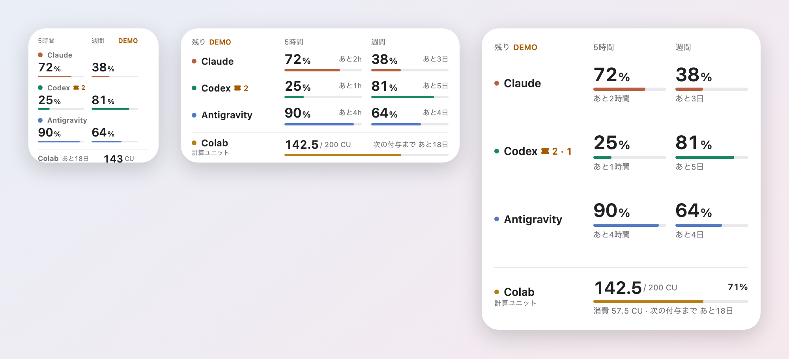
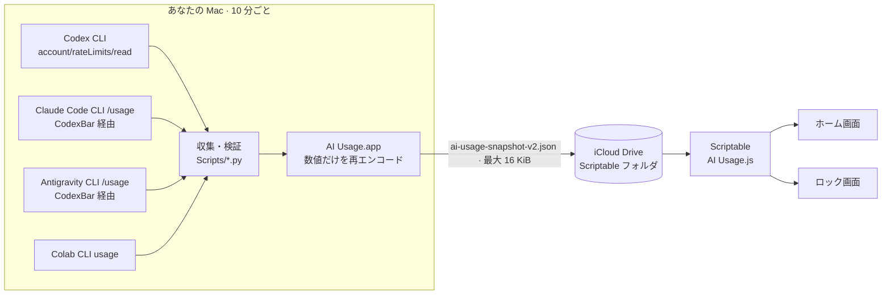

<div align="center">

[English](README.md) · **日本語** · [简体中文](README.zh-CN.md) · [한국어](README.ko.md)



# No Token Left Behind

### レートリミット、寝かせるな。

**Claude Code・OpenAI Codex・Gemini（Antigravity）・Google Colab の利用上限を、iPhone のホーム画面とロック画面に出す無料・オープンソースのウィジェット。**<br>
5 時間枠と週の枠があと何 % 残っているか、いつ回復するかが、ひと目でわかります。

[](https://github.com/tamutamu0/no-token-left-behind/stargazers)
[](https://github.com/tamutamu0/no-token-left-behind/actions/workflows/ci.yml)
[](LICENSE)


-supported-4285F4)


[**クイックスタート**](#クイックスタート) · [**デモで試す**](#クイックスタート) · [**仕組み**](#仕組み) · [**よくある質問**](#よくある質問)

</div>

---

## 目次

- [なぜ必要？](#なぜ必要)
- [こんな人に](#こんな人に)
- [特長](#特長)
- [ウィジェットの見方](#ウィジェットの見方)
- [ギャラリー](#ギャラリー)
- [クイックスタート](#クイックスタート)
- [必要なもの](#必要なもの)
- [仕組み](#仕組み)
- [設定](#設定)
- [Colab の「次の付与まで」](#colab-の次の付与まで)
- [よく使うコマンド](#よく使うコマンド)
- [プライバシーと安全性](#プライバシーと安全性)
- [よくある質問](#よくある質問)
- [困ったときは](#困ったときは)
- [ロードマップ](#ロードマップ)
- [貢献](#貢献) · [ライセンス](#ライセンス)

## なぜ必要？

Claude・Codex・Gemini には 5 時間枠と週の枠があり、どちらも時間が来ればリセットされます。**使っても、使わなくても。** 60% 残したままリセットされた枠は、作れたはずの機能 1 本分です。

- 😴 **寝かせた枠は、ただの損。**「残り 72% · あと 2h」なら、あのリファクタリングは*今*始めるべき。
- 🧱 **作業の途中で壁に激突しない。** 大きな移行を頼む*前に*「実は残り 8%」と気づける。
- 🔀 **複数プランの使い分けに。** Claude が尽きても、ひと目で Codex がまだ 81% あるとわかる。
- 💳 **Colab の計算ユニットも取りこぼさない。** 残高と次の付与までの日数がわかるから、補充される前に使い切れる。

ターミナルもダッシュボードも Mac も開かずに、ロック画面をちらっと見るだけ。

<p align="center"></p>

## こんな人に

| 契約しているもの | ウィジェットに出るもの |
|---|---|
| **Claude Pro / Max**（Claude Code） | 5 時間のセッション枠と週の枠、回復までの時間 |
| **ChatGPT Plus / Pro**（Codex CLI） | Codex の 5 時間枠と週の枠 |
| **Antigravity**（無料、または Google AI Pro / Ultra） | Gemini モデル枠の 5 時間・週 |
| **Colab Pro / Pro+**（または Colab 付きの Google AI プラン） | 残りの計算ユニットと、次の付与までの日数 |

好きな組み合わせで使えます。つないでいないサービスは「—」になるだけです。

仕組みをひとことで言うと、Mac にはすでに公式 CLI がログイン済みで入っています。Mac アプリが 10 分ごとにその公式 CLI だけに残りを聞き、**数値だけ**を iCloud Drive に置きます。iPhone の小さな [Scriptable](https://scriptable.app/) スクリプトが、それをウィジェットにします。**サーバーなし。API キーなし。ブラウザの Cookie なし。有料の Apple Developer 登録なし。**

## 特長

| | |
|---|---|
| 🧭 **4 サービスを 1 枚に** | Claude と Codex（5 時間・週間）、Antigravity（Gemini の 5 時間・週間）、Google Colab（計算ユニット）。 |
| ⏱️ **いつ戻るかも分かる** | どの枠も、残りと回復までの時間を表示。「72% · あと 2h」。 |
| 💳 **Colab は残高として** | 計算ユニットは時間で戻る枠ではなく、減っていく残高。区切って表示し、残りの CU と次の付与までの日数を出します。付与日は**実際の履歴から学習**します。 |
| 🔒 **ロック画面にも** | アクティビティ風のリング、細いバーの表、時計の上の 1 行。リングは、いちばん残りが少ないサービスを自動で表示します。 |
| 🎨 **2 つのスタイル** | リング（既定）と、数字とバーの表形式。ウィジェットごとに `rings` / `table` で選ぶか、全体に設定できます。 |
| 🌐 **多言語** | ウィジェットは英語・日本語・中国語（簡体字）・韓国語（iPhone の言語に追従）。Mac・iPhone アプリは英語と日本語。 |
| 🧪 **数字をごまかさない** | 15 分以上古い値はオレンジ。回復時刻を過ぎた枠は 100% と決めつけず「再取得待ち」。 |
| 🩺 **自己診断** | `make doctor` が CLI・ログイン・Mac アプリ・iCloud への書き出しを点検し、直し方まで表示します。 |
| 🛡️ **数値だけ** | 問い合わせるのは公式 CLI だけ。Cookie もトークンもブラウザ操作もなし。iCloud のファイルにあるのは % と時刻だけです。 |

## ウィジェットの見方

<p align="center"></p>

- **列**がサービスです。**外側のリング**が 5 時間枠、**内側のリング**（淡いトーン）が週の枠です。
- リングの中の**大きい数字**が 5 時間の残り %、**小さい数字**が週の残り % です。
- リングの下は、それぞれの**回復までの時間**です。左端の `5h` / `週` が、2 行の意味を全列まとめて示します。
- 5 時間枠がないプランは、**リング 1 本**と数字 1 つになります。「—」も空のリングも出しません。
- **Colab** は時間で戻る枠ではなく残高です。リングの中に残りの CU、下に次の付与までの日数を出します。
- 15 分以上前の値はサービス名が**オレンジ**になり、いちばん古い値の経過時間（「18分前」）を右上に 1 回だけ出します。

## ギャラリー

<table>
<tr>
<td width="50%"></td>
<td width="50%"></td>
</tr>
<tr>
<td align="center"><b>ダークモード</b> — システムの外観に追従。</td>
<td align="center"><b>ロック画面</b> — 1 行・長方形・リング（外側が 5 時間、内側が週間）。</td>
</tr>
<tr>
<td colspan="2"></td>
</tr>
<tr>
<td colspan="2" align="center"><b>表形式</b> — 数字とバーで見たいなら、Parameter に <code>table</code> と入れます。</td>
</tr>
</table>

| ウィジェット | 表示内容 |
|---|---|
| **小** | 4 つのリングの中に 5 時間・週の残り %。Colab の残り CU と付与までの日数。 |
| **中** | 各リングの下に回復までの時間（「あと 2h」「あと 3日」）を追加。 |
| **大** | 大きなリングと、省略なしの回復時刻（「あと 2時間」）。Colab の消費量と付与までの日数。 |
| **ロック · 1 行** | いちばん先に尽きそうな枠。例「Codex 5h 25% · あと 1h」。 |
| **ロック · 長方形** | 各サービスの 5h/週の残り % と細いバー。最下段に Colab。 |
| **ロック · 円形** | 1 サービスを二重のリングで。既定は残りが最も少ないサービス。パラメータで固定も可能。 |

## クイックスタート

> **まず見た目だけ試したいなら**：Scriptable を入れてスクリプトを置き（手順 3）、ウィジェットの *Parameter* に `demo` と入れてください。Mac なしで、架空データの完全なウィジェットが表示されます。

**1. Mac アプリをビルドして入れる**（約 2 分）

```bash
git clone https://github.com/tamutamu0/no-token-left-behind.git
cd no-token-left-behind
make install          # ビルド → ローカル署名 → ログイン時に自動起動
```

**2. 使うサービスをつなぐ**（使わないものは飛ばして OK）

```bash
brew install --cask codexbar                      # Claude / Antigravity の CLI を動かす補助ツール
python3 Scripts/install_statuslines.py            # Claude / Antigravity の statusLine も取り込む（既存設定は上書きしない）

# Google Colab：公式 CLI をアプリが探す場所に入れ、初回だけ認可
python3 -m venv "$HOME/Library/Application Support/AIUsage/ColabRuntime"
"$HOME/Library/Application Support/AIUsage/ColabRuntime/bin/pip" install google-colab-cli
"$HOME/Library/Application Support/AIUsage/ColabRuntime/bin/colab" --auth oauth2 usage
```

Codex は `codex login` 済みなら追加の設定は不要です。Mac アプリを開いて **取得を開始** を押します。

**3. iPhone に置く**

```bash
make widget           # スクリプトを iCloud Drive › Scriptable にコピー
```

1. Mac アプリの **Scriptable フォルダを選ぶ** で **iCloud Drive › Scriptable** を選びます。
2. iPhone のホーム画面を長押し → **編集** → **ウィジェットを追加** → **Scriptable** → サイズを選ぶ → ウィジェットをタップ → **Script: AI Usage**。
3. ロック画面：長押し → **カスタマイズ** → ウィジェット欄をタップ → **Scriptable**。

**4. 全体を点検する**

```bash
make doctor
```

```text
Codex
  ✓ Codex CLI          /opt/homebrew/bin/codex · last collection succeeded
Claude
  ✓ Claude Code CLI    /opt/homebrew/bin/claude
  ✓ CodexBar           /opt/homebrew/bin/codexbar
  ✓ Collection         last collection succeeded
...
iPhone
  ✓ Usage file         updated 1 min ago

16 ok · 0 warning(s) · 0 problem(s)
```

各手順の詳細とつまずきやすい点は[導入ガイド](docs/ja/setup.md)にまとめています。

## 必要なもの

| | |
|---|---|
| **iPhone** | ロック画面ウィジェットには iOS 16 以降 · [Scriptable](https://apps.apple.com/app/scriptable/id1405459188)（無料） · iCloud Drive |
| **Mac** | macOS 14 以降（Apple シリコン / Intel） · ビルド用の Xcode 16 以降 · 同じ Apple アカウントの iCloud Drive |
| **Codex** | 公式 [Codex CLI](https://github.com/openai/codex) にログイン済み |
| **Claude** | 公式 [Claude Code](https://code.claude.com/) CLI にログイン済み（初回セットアップ完了） · [CodexBar](https://codexbar.app/) |
| **Antigravity** | 公式 Antigravity CLI にログイン済み · CodexBar |
| **Colab** | 公式 [google-colab-cli](https://github.com/googlecolab/google-colab-cli) を認可済み · 計算ユニットを含むプラン |

一部のサービスだけでも使えます。つないでいないサービスは「—」になります。

## 仕組み



1. Mac アプリが 10 分ごとに収集処理を実行します。問い合わせ先は**ログイン済みの公式 CLI** だけで、聞くのは残量だけです。
2. 結果を許可した項目（サービス・使用率・回復時刻・残高・観測時刻）だけに絞って検証し、iCloud Drive に原子的に書き込みます。
3. Scriptable のスクリプトがもう一度検証してから描画します。読み込みに失敗したときは、前回の検証済みの値を本当の観測時刻つきで表示し続けます。

ファイルの形式、鮮度の扱い、Colab の付与の検出は[仕組み](docs/ja/how-it-works.md)に詳しく書いています。

## 設定

### ウィジェットの Parameter

ウィジェットを長押し → **ウィジェットを編集** → **Parameter**。空白区切りで、どれも任意です。

| 書き方 | 効果 |
|---|---|
| （空欄） | 実データ |
| `demo` | 架空データ。Mac なしで試せます |
| `rings` · `table` | このウィジェットのホーム画面のスタイル（既定はリング） |
| `claude` · `codex` · `antigravity` · `colab` | ロック画面のリング・1 行に出すサービスを固定（既定は残りが最も少ないもの） |
| `grant=4` | このウィジェットだけ、毎月 4 日を Colab の付与日として扱う |
| `lang=en` · `ja` · `zh` · `ko` | 表示言語を固定（既定は iPhone の言語。対応外なら英語） |

例：`colab` · `demo claude` · `colab grant=15 lang=ja`

### 設定ファイル

`iCloud Drive › Scriptable › ai-usage-settings.json` は、すべてのウィジェットに効きます。

```json
{ "colabGrantDay": 4, "style": "rings" }
```

`style` は `"rings"`（既定）か `"table"` です。ウィジェットの Parameter に `rings` / `table` があれば、そちらが優先されます。

### CLI の場所

各 CLI は `$AIUSAGE_<名前>_PATH` → `PATH` → よく使われる場所（`/opt/homebrew/bin`、`/usr/local/bin`、`~/.local/bin`、`~/.npm-global/bin`、`~/.bun/bin`、`~/.volta/bin`、CodexBar アプリ内）の順に探します。固定したいときは次のようにします。

```bash
launchctl setenv AIUSAGE_CODEX_PATH /path/to/codex   # 名前: CODEX, CLAUDE, CODEXBAR, AGY, COLAB
```

## Colab の「次の付与まで」

Colab の CLI が返すのは現在の残高だけで、付与日も失効日も分かりません。しかも Google AI プランの付与は[遅れることが報告されています](https://github.com/googlecolab/colabtools/issues/6127)。そこでウィジェットは次の順で判断します。

1. **学習**：観測のたびに前回と比べ、**10 CU 以上増えていたら付与として記録**します（`colab-grants.json`、Mac 内に保存）。一度でも観測すれば、その日を毎月の付与日にします。
2. **設定**：まだ観測していない間は `colabGrantDay`（または Parameter の `grant=`）を使います。Google AI プランなら、Google One の「次回のお支払い」の日が目安です。
3. **付与待ち**：予定日を過ぎても付与を観測できないときは、新しいカウントダウンを始めず「**付与待ち（予定 4 日）**」と表示します。

使い残した CU が次の付与で消えるのかは、Google AI プランについては明示されていません（Colab Pro の分は 90 日で失効）。「次に補充される日まで」の目安として見てください。

## よく使うコマンド

| コマンド | 内容 |
|---|---|
| `make install` | Mac アプリをビルド・ローカル署名・ログイン項目に登録・再起動 |
| `make widget` | 最新のウィジェットスクリプトを iCloud Drive › Scriptable にコピー |
| `make doctor` | CLI・ログイン・Mac アプリ・書き出しを点検し、直し方を表示 |
| `make test` | Python・JavaScript・Swift のテストを実行 |
| `make screenshots` | README の画像を架空データから 4 言語分作り直す |
| `make help` | すべてのコマンドを表示 |

## プライバシーと安全性

- 問い合わせるのは、あなたがログイン済みの**公式 CLI だけ**です。パスワード・Cookie・OAuth トークンは読みません。ブラウザの自動操作もしません。
- **Mac の外に出るのは数値だけ**です（サービス・取得元の種類・使用率・回復時刻・残高・観測時刻）。それ以外の項目は書き出す前に捨てます。
- **ウィジェットに通信のコードはありません**。iCloud Drive のファイルを読むだけです。
- チャットの開始、モデルの実行、購入、枠のリセットを行う経路は**ありません**。
- iCloud のファイルはあなたの Apple アカウントに保存されます。共有フォルダは選ばないでください。

詳細と制約：[安全性](docs/ja/security.md) · 脆弱性の報告：[SECURITY.md](SECURITY.md)

## よくある質問

<details>
<summary><b>iPhone で Claude Code や Codex の利用上限（残り）を確認するには？</b></summary>

まさにそのためのツールです。一度設定すれば（[クイックスタート](#クイックスタート)）、ホーム画面とロック画面に 5 時間枠・週の枠の残り % と回復までの時間が出ます。
</details>

<details>
<summary><b>無料ですか？</b></summary>

無料です（MIT ライセンス）。Scriptable も無料で、有料の Apple Developer 登録も要りません。必要なのは、すでに契約している AI のプランだけです。
</details>

<details>
<summary><b>使うと枠やトークンが減りますか？</b></summary>

減りません。残量を読むだけです。Codex には接続時の `initialize` と `account/rateLimits/read` を 1 回、Claude と Antigravity は `/usage`、Colab は `usage` を実行するだけで、プロンプトの送信やモデルの呼び出しはしません。
</details>

<details>
<summary><b>なぜ Mac が必要なのですか？</b></summary>

公式 CLI とそのログイン情報はパソコンの中にあり、iOS では動かせないためです。問い合わせは Mac が行い、iPhone は小さなファイルを読むだけです。
</details>

<details>
<summary><b>数字がオレンジなのはなぜ？</b></summary>

残りが少ない（20% 以下）か、15 分以上前の値です。たいていは Mac がスリープしています。中・大サイズでは、サービス名の下に経過時間が出ます。
</details>

<details>
<summary><b>「再取得待ち」とは？</b></summary>

回復時刻は過ぎたものの、まだ新しい値が届いていない状態です。次の取得で確認できるまで、100% に戻ったとはみなしません。
</details>

<details>
<summary><b>一部のサービスだけ使えますか？</b></summary>

使えます。使うものだけつなげば、残りは「—」になります。Colab も任意です。
</details>

<details>
<summary><b>Intel Mac や、Homebrew 以外で入れたツールでも動きますか？</b></summary>

動きます。CLI は `PATH` とよく使われる場所から探し、必要なら `AIUSAGE_<名前>_PATH` で固定できます。見つかった場所は `make doctor` で確認できます。
</details>

<details>
<summary><b>対応言語は？</b></summary>

ウィジェットは英語・日本語・中国語（簡体字）・韓国語で、iPhone の言語に追従します（Parameter の `lang=` でも指定可能）。Mac・iPhone アプリは英語と日本語で、システムの言語に追従します。ドキュメントは英語と日本語、この README は 4 言語です。
</details>

<details>
<summary><b>Anthropic・OpenAI・Google の公式アプリですか？</b></summary>

いいえ。公式ツールの出力を読む、独立したオープンソースのプロジェクトです。製品名は各社に帰属します。
</details>

## 困ったときは

まず `make doctor` を実行してください。壊れている箇所と、直すためのコマンドを表示します。よくあるケース：

| 症状 | 考えられる原因 |
|---|---|
| すべて「—」 | 取得が始まっていない、Scriptable フォルダを選んでいない、iCloud の同期がまだ |
| 1 サービスだけ「—」 | その CLI にログインしていない（Claude は初回セットアップの完了も必要） |
| 全部オレンジ | Mac がスリープしているか、アプリが動いていない |
| アプリを更新したら止まった | `make install` をもう一度。初回は Scriptable フォルダの選び直しが必要なことがあります |
| ウィジェットが変わらない | 再描画のタイミングは iOS が決めます。ウィジェットをタップすると読み直します |

詳しくは[導入ガイド](docs/ja/setup.md#困ったときは)を参照してください。

## ロードマップ

- [ ] 署名・公証済みの Mac アプリを GitHub Releases で配布（Xcode 不要に）
- [ ] CLI が残量を出すようになったサービスの追加
- [ ] アプリの対応言語を追加（ウィジェットは 4 言語対応済み）
- [ ] 残りがしきい値を下回ったときの通知（任意）

アイデアやプルリクエストを歓迎します。

## 貢献

不具合の報告、翻訳、新しいサービスの追加を歓迎します。コードの構成、テストの実行、言語やサービスの追加方法は [CONTRIBUTING.md](CONTRIBUTING.md) にまとめています。不具合の報告には `python3 Scripts/doctor.py --json` の出力を添えてください。

## 謝辞

Simon B. Støvring 氏の [Scriptable](https://scriptable.app/) のおかげで、App Store のアプリなしで iPhone のウィジェットを作れます。Claude と Antigravity の CLI は [CodexBar](https://codexbar.app/) が動かします。Xcode プロジェクトは [XcodeGen](https://github.com/yonaskolb/XcodeGen) で生成しています。

## 応援してください

5 時間枠を 1 回でもムダにせずに済んだら、⭐ をつけてもらえると、次の誰かに届きやすくなります。

[](https://star-history.com/#tamutamu0/no-token-left-behind&Date)

## ライセンス

[MIT](LICENSE)。Claude・Codex・Antigravity・Google Colab などの名称は各権利者の商標です。このプロジェクトは各社と提携・承認関係にありません。
