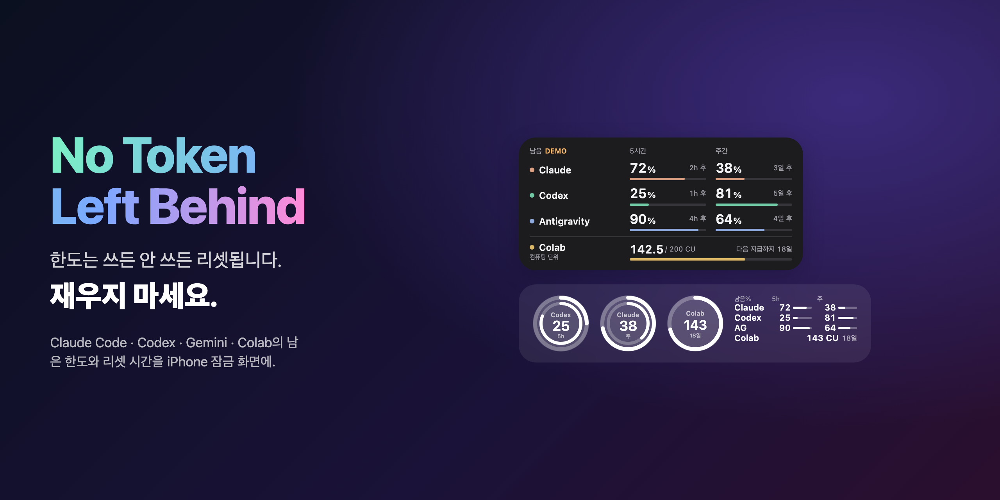
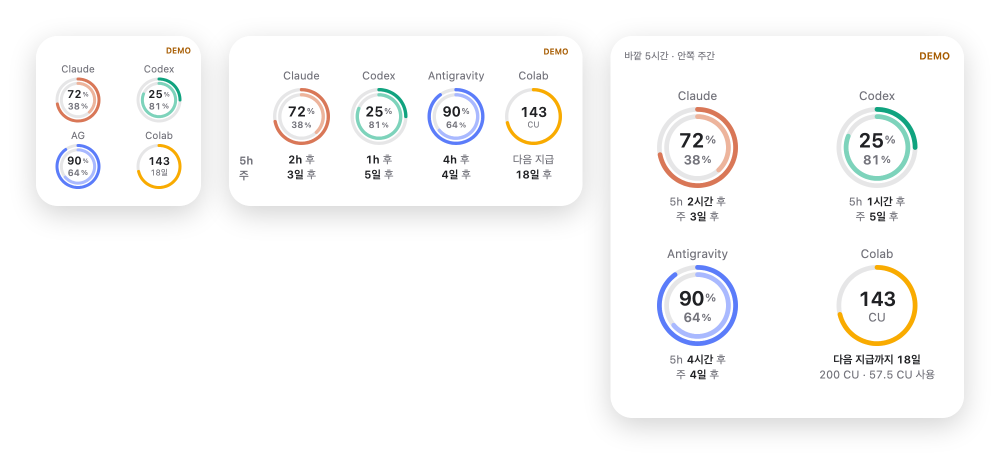
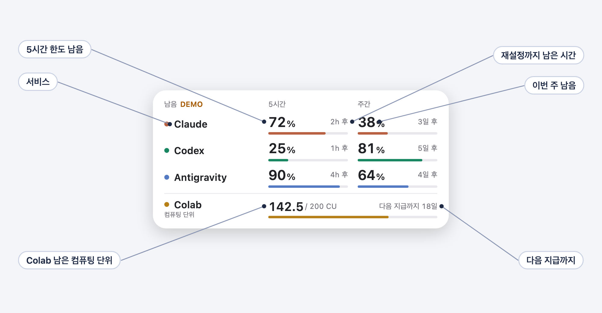
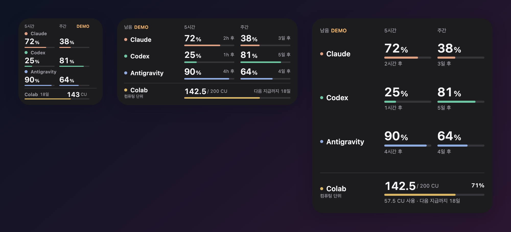
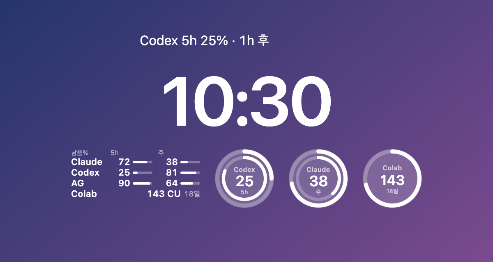
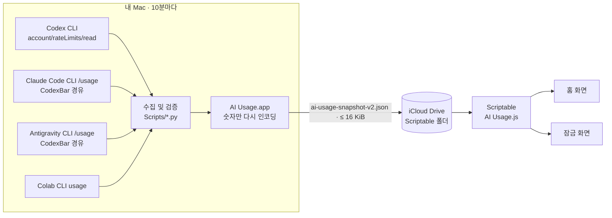

<div align="center">

[English](README.md) · [日本語](README.ja.md) · [简体中文](README.zh-CN.md) · **한국어**



# No Token Left Behind

### 한도는 쓰든 안 쓰든 리셋됩니다. 재우지 마세요.

**Claude Code, OpenAI Codex, Gemini(Antigravity), Google Colab의 사용 한도를 iPhone 홈 화면과 잠금 화면에 보여 주는 무료 오픈소스 위젯.**<br>
5시간 한도와 주간 한도가 얼마나 남았는지, 언제 리셋되는지 한눈에 확인하세요.

[](https://github.com/tamutamu0/no-token-left-behind/stargazers)
[](https://github.com/tamutamu0/no-token-left-behind/actions/workflows/ci.yml)
[](LICENSE)


-supported-4285F4)


[**빠른 시작**](#빠른-시작) · [**데모 체험**](#빠른-시작) · [**작동 방식**](#작동-방식) · [**자주 묻는 질문**](#자주-묻는-질문)

</div>

> 자세한 문서는 현재 [English](docs/en/setup.md)와 [日本語](docs/ja/setup.md)로 제공됩니다.

---

## 목차

- [왜 필요할까](#왜-필요할까)
- [이런 분께](#이런-분께)
- [주요 특징](#주요-특징)
- [위젯 읽는 법](#위젯-읽는-법)
- [갤러리](#갤러리)
- [빠른 시작](#빠른-시작)
- [요구 사항](#요구-사항)
- [작동 방식](#작동-방식)
- [설정](#설정)
- [Colab: "다음 지급까지 N일"](#colab-다음-지급까지-n일)
- [자주 쓰는 명령](#자주-쓰는-명령)
- [개인정보와 보안](#개인정보와-보안)
- [자주 묻는 질문](#자주-묻는-질문)
- [문제 해결](#문제-해결)
- [라이선스](#라이선스)

## 왜 필요할까

Claude, Codex, Gemini에는 5시간 한도와 주간 한도가 있고, 시간이 되면 리셋됩니다. **썼든 안 썼든.** 60%를 남긴 채 리셋된 한도는 만들 수 있었던 기능 하나입니다.

- 😴 **잠자는 한도는 그냥 손해.** "72% · 2h 후"라면 그 리팩터링은 *지금* 시작할 때입니다.
- 🧱 **작업 도중 벽에 부딪히지 않기.** 큰 마이그레이션을 맡기기 *전에* "사실 8% 남음"을 알 수 있습니다.
- 🔀 **여러 요금제를 오가는 분께.** Claude가 바닥나도 Codex가 아직 81% 남은 걸 한눈에.
- 💳 **Colab 컴퓨팅 단위도 놓치지 않기.** 잔액과 다음 지급까지 남은 날짜를 보고, 충전되기 전에 다 쓰세요.

터미널도, 대시보드도, Mac도 열 필요 없이 잠금 화면을 슬쩍 보기만 하면 됩니다.

<p align="center"></p>

## 이런 분께

| 구독 중인 서비스 | 위젯에 표시되는 내용 |
|---|---|
| **Claude Pro / Max** (Claude Code) | 5시간 세션 한도와 주간 한도, 리셋 카운트다운 |
| **ChatGPT Plus / Pro** (Codex CLI) | Codex 5시간·주간 한도 |
| **Antigravity** (무료 또는 Google AI Pro / Ultra) | Gemini 모델 한도, 5시간·주간 |
| **Colab Pro / Pro+** (또는 Colab이 포함된 Google AI 요금제) | 남은 컴퓨팅 단위와 다음 지급까지 남은 날짜 |

원하는 조합으로 쓰면 됩니다. 연결하지 않은 서비스는 "—"로만 표시됩니다.

한마디로: Mac에는 이미 공식 CLI가 로그인되어 있습니다. Mac 앱이 10분마다 그 공식 CLI에만 남은 양을 묻고, **숫자만** iCloud Drive에 둡니다. iPhone의 작은 [Scriptable](https://scriptable.app/) 스크립트가 그것을 위젯으로 바꿉니다. **서버 없음. API 키 없음. 브라우저 쿠키 없음. 유료 Apple Developer 계정 불필요.**

## 주요 특징

| | |
|---|---|
| 🧭 **네 가지 서비스를 한 장에** | Claude와 Codex(5시간 + 주간), Antigravity(Gemini 5시간 + 주간), Google Colab(컴퓨팅 단위). |
| ⏱️ **언제 돌아오는지까지** | 모든 한도에 남은 양과 재설정 시간을 표시합니다. 예: "72% · 2h 후". |
| 💳 **Colab은 잔액으로** | 컴퓨팅 단위는 시간이 지나면 돌아오는 한도가 아니라 줄어드는 잔액입니다. 따로 구분해 남은 CU와 다음 월간 지급까지의 일수를 표시하며, **실제 지급일을 기록에서 학습**합니다. |
| 🔒 **잠금 화면도** | 피트니스 앱 같은 이중 링, 작은 막대 표, 시계 위 한 줄. 링은 가장 적게 남은 서비스를 자동으로 보여 줍니다. |
| 🌐 **다국어** | 위젯은 영어·일본어·중국어(간체)·한국어(iPhone 언어를 따름). Mac·iPhone 앱은 영어와 일본어. |
| 🧪 **숫자를 속이지 않음** | 15분 이상 지난 값은 주황색으로 표시합니다. 재설정 시간이 지난 한도는 100%로 가정하지 않고 "새로고침 대기"로 표시합니다. |
| 🩺 **자가 진단** | `make doctor`가 모든 CLI, 로그인, Mac 앱, iCloud 내보내기를 점검하고 해결 방법까지 알려 줍니다. |
| 🛡️ **숫자만** | 공식 CLI에만 묻습니다. 쿠키도, 토큰도, 브라우저 자동화도 없습니다. iCloud 파일에는 퍼센트와 시각만 있습니다. |

## 위젯 읽는 법

<p align="center"></p>

- **행**은 서비스, **열**은 5시간 한도와 주간 한도입니다.
- **큰 숫자**가 남은 양, **막대**가 같은 양을 한눈에, 작은 글씨가 **재설정까지 남은 시간**입니다.
- 5시간 한도가 없는 서비스(요금제에 따라 다름)는 해당 칸을 **비워 둡니다**. "—"도, 빈 막대도 표시하지 않습니다.
- 구분선 아래는 **Colab**입니다. 남은 CU, 확인된 경우 총량, **다음 지급까지의 일수**를 표시합니다.
- **주황색**은 "20% 이하"이거나 "15분 이상 지난 값"이라는 뜻입니다.

## 갤러리

<table>
<tr>
<td width="50%"></td>
<td width="50%"></td>
</tr>
<tr>
<td align="center"><b>다크 모드</b> — 시스템 화면 모드를 따릅니다.</td>
<td align="center"><b>잠금 화면</b> — 한 줄, 직사각형, 링(바깥쪽 5시간, 안쪽 주간).</td>
</tr>
</table>

| 위젯 | 표시 내용 |
|---|---|
| **소** | 서비스별 5시간·주간 남은 %와 막대. Colab 남은 CU와 지급까지의 일수. |
| **중** | 각 숫자 옆에 "2h 후" 같은 재설정 시간을 추가. |
| **대** | 전체 재설정 시간("4시간 59분 후"), Colab 사용량과 지급 카운트다운. |
| **잠금 · 한 줄** | 가장 먼저 소진될 한도. 예: "Codex 5h 25% · 1h 후". |
| **잠금 · 직사각형** | 서비스별 5h/주간 남은 %와 얇은 막대, 맨 아래에 Colab. |
| **잠금 · 원형** | 한 서비스를 이중 링으로. 기본값은 가장 적게 남은 서비스이며 매개변수로 고정할 수 있습니다. |

## 빠른 시작

> **먼저 보기만 하고 싶다면?** Scriptable을 설치하고 스크립트를 넣은 다음(3단계) 위젯의 *Parameter*를 `demo`로 설정하세요. Mac 없이 예시 데이터로 완전한 위젯을 볼 수 있습니다.

**1. Mac 앱 빌드 및 설치**(약 2분)

```bash
git clone https://github.com/tamutamu0/no-token-left-behind.git
cd no-token-left-behind
make install          # 빌드 → 로컬 서명 → 로그인 시 자동 실행
```

**2. 사용하는 서비스 연결**(쓰지 않는 서비스는 건너뛰세요)

```bash
brew install --cask codexbar                      # Claude / Antigravity CLI를 구동하는 도우미
python3 Scripts/install_statuslines.py            # Claude / Antigravity statusLine도 읽기(기존 설정은 덮어쓰지 않음)

# Google Colab: 앱이 찾는 위치에 공식 CLI를 설치하고 한 번 인증
python3 -m venv "$HOME/Library/Application Support/AIUsage/ColabRuntime"
"$HOME/Library/Application Support/AIUsage/ColabRuntime/bin/pip" install google-colab-cli
"$HOME/Library/Application Support/AIUsage/ColabRuntime/bin/colab" --auth oauth2 usage
```

`codex login`을 했다면 Codex는 추가 설정이 필요 없습니다. Mac 앱을 열고 **Start collecting**을 누르세요.

**3. iPhone에 배치**

```bash
make widget           # 스크립트를 iCloud Drive › Scriptable로 복사
```

1. Mac 앱에서 **Choose Scriptable folder** → **iCloud Drive › Scriptable**을 선택합니다.
2. iPhone 홈 화면을 길게 누르기 → **편집** → **위젯 추가** → **Scriptable** → 크기 선택 → 위젯을 탭 → **Script: AI Usage**.
3. 잠금 화면: 길게 누르기 → **사용자화** → 위젯 영역을 탭 → **Scriptable**.

**4. 전체 점검**

```bash
make doctor
```

## 요구 사항

| | |
|---|---|
| **iPhone** | 잠금 화면 위젯은 iOS 16 이상 · [Scriptable](https://apps.apple.com/app/scriptable/id1405459188)(무료) · iCloud Drive |
| **Mac** | macOS 14 이상(Apple 실리콘 또는 Intel) · 빌드용 Xcode 16 이상 · 같은 Apple 계정의 iCloud Drive |
| **Codex** | 로그인된 공식 [Codex CLI](https://github.com/openai/codex) |
| **Claude** | 로그인 및 첫 실행 설정을 마친 공식 [Claude Code](https://code.claude.com/) CLI · [CodexBar](https://codexbar.app/) |
| **Antigravity** | 로그인된 공식 Antigravity CLI · CodexBar |
| **Colab** | 인증된 공식 [google-colab-cli](https://github.com/googlecolab/google-colab-cli) · 컴퓨팅 단위가 포함된 요금제 |

일부 서비스만 사용해도 됩니다. 연결하지 않은 서비스는 "—"로 표시됩니다.

## 작동 방식



1. Mac 앱이 10분마다 수집기를 실행합니다. 각 수집기는 **로그인된 공식 CLI**에 한도만 묻습니다.
2. 결과를 허용 목록(서비스, 사용률, 재설정 시간, 잔액, 관측 시각)으로 줄이고 검증한 뒤 iCloud Drive에 원자적으로 기록합니다.
3. Scriptable 스크립트가 파일을 다시 검증한 뒤 위젯을 그립니다. 읽기에 실패하면 마지막으로 검증된 값을 실제 관측 시각과 함께 계속 표시합니다.

## 설정

### 위젯 매개변수

위젯을 길게 누르기 → **위젯 편집** → **Parameter**. 공백으로 구분하며 모두 선택 사항입니다.

| 입력 | 효과 |
|---|---|
| (비워 둠) | 실시간 데이터 |
| `demo` | 예시 데이터 — Mac 없이 사용해 보기 |
| `claude` · `codex` · `antigravity` · `colab` | 잠금 화면 링 / 한 줄 위젯의 서비스를 고정(기본값: 가장 적게 남은 서비스) |
| `grant=4` | 이 위젯에서 매월 4일을 Colab 지급일로 간주 |
| `lang=en` · `ja` · `zh` · `ko` | 표시 언어를 고정(기본값: iPhone 언어, 지원하지 않으면 영어) |

### 설정 파일

`iCloud Drive › Scriptable › ai-usage-settings.json`은 모든 위젯에 적용됩니다.

```json
{ "colabGrantDay": 4 }
```

### CLI 찾기

`$AIUSAGE_<이름>_PATH` → `PATH` → 일반적인 위치(`/opt/homebrew/bin`, `/usr/local/bin`, `~/.local/bin`, `~/.npm-global/bin`, `~/.bun/bin`, `~/.volta/bin`, CodexBar 앱 내부) 순서로 찾습니다. 고정하려면:

```bash
launchctl setenv AIUSAGE_CODEX_PATH /path/to/codex   # 이름: CODEX, CLAUDE, CODEXBAR, AGY, COLAB
```

## Colab: "다음 지급까지 N일"

Colab CLI는 현재 잔액만 알려 주며 지급일이나 만료일은 알려 주지 않습니다. 게다가 Google AI 요금제의 지급이 [늦게 도착한다는 보고](https://github.com/googlecolab/colabtools/issues/6127)도 있습니다. 그래서 위젯은 다음과 같이 판단합니다.

1. **학습**: 매번 관측할 때 이전 값과 비교해 **10 CU 이상 늘었으면 지급으로 기록**합니다(`colab-grants.json`, Mac에 저장). 한 번 관측되면 그날을 매월 지급일로 사용합니다.
2. **설정**: 그 전까지는 `colabGrantDay`(또는 매개변수의 `grant=`)를 사용합니다. Google AI 요금제라면 Google One의 "다음 결제일"이 좋은 기준입니다.
3. **대기**: 예정일이 지났는데 지급이 관측되지 않으면 새 카운트다운을 시작하지 않고 "**지급 대기 (4일 예정)**"로 표시합니다.

## 자주 쓰는 명령

| 명령 | 하는 일 |
|---|---|
| `make install` | Mac 앱 빌드, 로컬 서명, 로그인 항목 등록, 재시작 |
| `make widget` | 최신 위젯 스크립트를 iCloud Drive › Scriptable로 복사 |
| `make doctor` | CLI, 로그인, Mac 앱, 내보내기를 점검하고 해결 방법 표시 |
| `make test` | Python, JavaScript, Swift 테스트 실행 |
| `make screenshots` | 예시 데이터로 네 가지 언어의 README 이미지를 다시 생성 |

## 개인정보와 보안

- 이미 로그인한 **공식 CLI에만** 묻습니다. 비밀번호, 쿠키, OAuth 토큰을 읽지 않으며 브라우저 자동화도 없습니다.
- **Mac 밖으로 나가는 것은 숫자뿐입니다**: 서비스, 출처 유형, 사용률, 재설정 시간, 잔액, 관측 시각.
- **위젯에는 네트워크 코드가 없습니다.** iCloud Drive의 파일만 읽습니다.
- 대화를 시작하거나, 모델을 실행하거나, 구매하거나, 한도를 재설정하는 코드 경로는 없습니다.

자세한 내용은 [Security(영어)](docs/en/security.md) · 취약점 신고: [SECURITY.md](SECURITY.md)

## 자주 묻는 질문

<details>
<summary><b>한도나 토큰이 소모되나요?</b></summary>

아니요. 남은 한도만 읽습니다. Codex에는 `initialize` 핸드셰이크와 `account/rateLimits/read` 한 번만 보내고, Claude와 Antigravity는 `/usage`, Colab은 `usage`만 실행합니다. 프롬프트를 보내거나 모델을 호출하지 않습니다.
</details>

<details>
<summary><b>왜 Mac이 필요한가요?</b></summary>

공식 CLI와 로그인 정보가 컴퓨터에 있고, iOS에서는 실행할 수 없기 때문입니다. 조회는 Mac이 하고 iPhone은 작은 파일만 읽습니다.
</details>

<details>
<summary><b>숫자가 주황색인 이유는?</b></summary>

남은 양이 적거나(20% 이하) 값이 15분 이상 지났기 때문입니다. 대개 Mac이 잠자기 상태입니다.
</details>

<details>
<summary><b>Anthropic, OpenAI, Google의 공식 앱인가요?</b></summary>

아니요. 공식 도구의 출력을 읽는 독립적인 오픈소스 프로젝트입니다. 제품명은 각 소유자에게 있습니다.
</details>

## 문제 해결

먼저 `make doctor`를 실행하세요. 문제가 있는 부분과 해결 명령을 알려 줍니다.

| 증상 | 가능한 원인 |
|---|---|
| 모든 값이 "—" | 수집을 시작하지 않았거나, Scriptable 폴더를 선택하지 않았거나, iCloud 동기화가 아직 안 됨 |
| 한 서비스만 "—" | 해당 CLI에 로그인하지 않음(Claude는 첫 실행 설정도 필요) |
| 모두 주황색 | Mac이 잠자기 상태이거나 앱이 실행 중이 아님 |
| 앱 업데이트 후 멈춤 | `make install`을 다시 실행. 처음에는 Scriptable 폴더를 다시 선택해야 할 수 있음 |

## 응원해 주세요

5시간 한도를 한 번이라도 허투루 버리지 않았다면, ⭐ 하나가 다음 사람에게 이 프로젝트를 알려 줍니다.

[](https://star-history.com/#tamutamu0/no-token-left-behind&Date)

## 라이선스

[MIT](LICENSE). Claude, Codex, Antigravity, Google Colab 등의 이름은 각 소유자의 상표입니다. 이 프로젝트는 해당 회사와 제휴하거나 승인받지 않았습니다.
