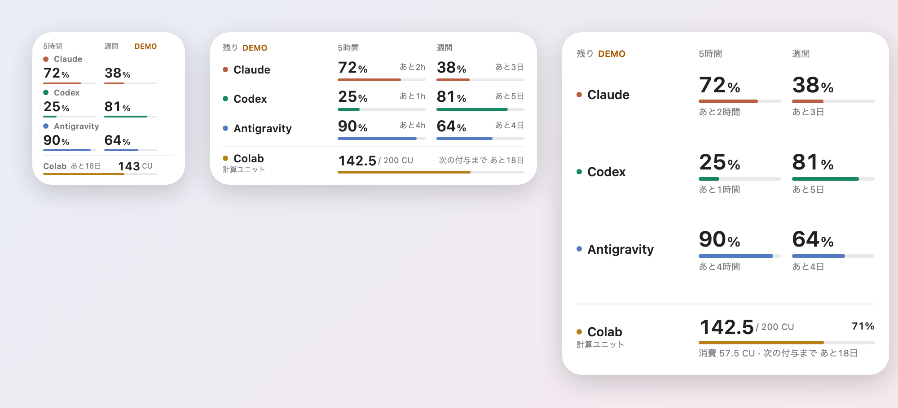
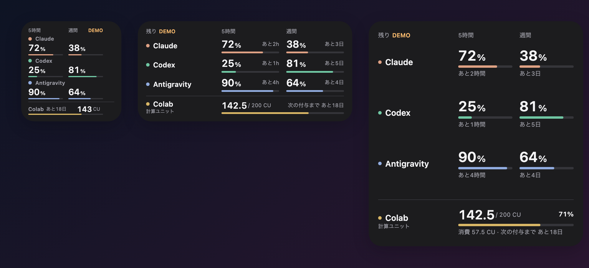
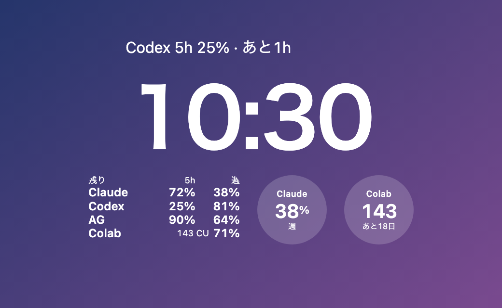
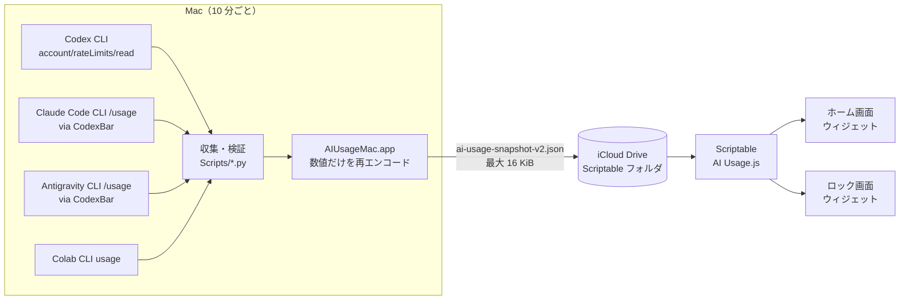

# AI Usage Widget

**Claude・Codex・Antigravity の利用枠と、Google Colab の計算ユニット残量を、iPhone のホーム画面・ロック画面ウィジェットで一目で確認するための仕組みです。**

Mac が各サービスの公式 CLI から残量を 10 分ごとに読み取り、数値だけを iCloud Drive に書き出します。iPhone 側は無料アプリ [Scriptable](https://scriptable.app/) のスクリプトがそのファイルを読んでウィジェットに描きます。有料の Apple Developer 登録やサーバーは要りません。

> A personal dashboard for AI subscription limits. A macOS collector reads the official CLIs of Claude Code, Codex, Antigravity and Google Colab every 10 minutes and writes numbers only to iCloud Drive; a Scriptable script renders Home Screen and Lock Screen widgets on iPhone. No paid Apple Developer account and no server required. (UI and docs are in Japanese.)





<p align="center"></p>

*スクリーンショットはすべて架空のデモデータです。*

---

## 目次

- [できること](#できること)
- [表示の見方](#表示の見方)
- [仕組み](#仕組み)
- [必要なもの](#必要なもの)
- [セットアップ](#セットアップ)
- [設定](#設定)
- [Colab の「次の付与まで」について](#colab-の次の付与までについて)
- [プライバシーと安全性](#プライバシーと安全性)
- [制限事項](#制限事項)
- [開発](#開発)
- [ドキュメント](#ドキュメント)

## できること

| | |
|---|---|
| **4 サービスを 1 枚に** | Claude（5 時間・週間）、Codex（5 時間・週間）、Antigravity（Gemini 枠の 5 時間・週間）、Google Colab（計算ユニット残高） |
| **回復までの時間** | 各枠の残り % に加えて「あと 2h」「あと 4 日 3 時間」のように回復までの時間を表示 |
| **Colab は残高として** | 時間で回復する枠とは分けて、CU の量・総量に対する割合・次の付与日までの日数を表示 |
| **ホーム画面 3 サイズ** | 小・中・大。iPhone のライト/ダークに自動追従 |
| **ロック画面 3 種類** | 時計の上の 1 行、長方形、円形（iOS 16 以降） |
| **古い値をごまかさない** | 15 分以上古い値はオレンジ。回復時刻を過ぎた枠は 100% に戻さず「再取得待ち」 |
| **数値しか送らない** | ログイン情報・会話・メールは iCloud にもスクリプトにも渡らない |

## 表示の見方

### ホーム画面

- **中・大サイズ**：行がサービス、列が「5 時間」「週間」。大きな数字が残り %、横（大サイズは下）が回復までの時間、下のバーが残量です。
- **小サイズ**：上の段にサービス名、下の段に 5 時間・週間の残り % とバー。回復時間は省略します。
- **5 時間枠がないサービス**（プランによっては Codex など）は、そのセルを空けます。「—」も出しません。
- **区切り線の下が Colab**：残っている CU を大きく、総量・割合・「次の付与まで あと○日」を小さく表示します。
- 残り 20% 以下と、15 分以上古い値はオレンジになります。

### ロック画面

| 種類 | 表示 |
|---|---|
| 1 行（時計の上） | いちばん先に尽きそうな枠。例「Codex 5h 25% · あと 1h」 |
| 長方形 | 4 サービスの 5h/週を小さな表で |
| 円形 | 1 サービスの残り %（Colab は残り CU と付与までの日数）。どれを出すかはパラメータで選択 |

ロック画面のウィジェットは iOS が壁紙に合わせて単色にするため、色ではなく明るさで区別しています。

## 仕組み



1. Mac の常駐アプリ（`AIUsageMac.app`）が 10 分ごとに収集スクリプトを実行します。各サービスへの問い合わせは、すでにログイン済みの**公式 CLI** に任せます。
2. 結果は許可した項目（サービス ID・残り %・回復時刻・残高・観測時刻）だけに絞って検証し、iCloud Drive の Scriptable フォルダへ 1 ファイルとして書き出します。
3. iPhone の Scriptable スクリプトがファイルを読み、もう一度検証してからウィジェットを描きます。読み込みに失敗したときは、前回の検証済みの値を観測時刻つきで表示し続けます。

詳しくは [docs/how-it-works.md](docs/how-it-works.md) を参照してください。

## 必要なもの

| 用途 | 必要なもの |
|---|---|
| iPhone | iOS 16 以降（ロック画面ウィジェットを使う場合）、[Scriptable](https://apps.apple.com/app/scriptable/id1405459188)（無料）、iCloud Drive |
| Mac | macOS 14 以降、Xcode（アプリのビルド用）、同じ Apple アカウントの iCloud Drive |
| Codex | 公式 [Codex CLI](https://github.com/openai/codex) にログイン済み |
| Claude | 公式 [Claude Code](https://code.claude.com/) CLI にログイン済み（初回セットアップ完了）＋ [CodexBar](https://codexbar.app/)（CLI の起動・解析補助） |
| Antigravity | 公式 Antigravity CLI にログイン済み＋ CodexBar |
| Colab | 公式 [google-colab-cli](https://github.com/googlecolab/google-colab-cli) と OAuth の認可、Colab の計算ユニットがある有料プラン |

使わないサービスは設定しなくて構いません。その行は「—」になります。

## セットアップ

所要時間は 20〜30 分ほどです。詳しい手順とつまずきやすい点は [docs/setup.md](docs/setup.md) にあります。

### 1. Mac アプリをビルドして起動

```bash
git clone https://github.com/tamutamu0/ai-usage-widget.git
cd ai-usage-widget
xcodebuild -project AIUsage.xcodeproj -scheme AIUsageMac -derivedDataPath build-mac CODE_SIGN_IDENTITY=- build
open build-mac/Build/Products/Debug/AIUsageMac.app
```

Xcode で `AIUsage.xcodeproj` を開き、`AIUsageMac` スキームで実行しても同じです。ログイン時に自動起動させるには次を実行します（このMac専用の署名を作り、ログイン項目に登録します）。

```bash
python3 Scripts/install_mac_startup.py
```

### 2. 取得元をつなぐ

```bash
# Colab CLI（このパスに置くと自動で使われます）
python3 -m venv "$HOME/Library/Application Support/AIUsage/ColabRuntime"
"$HOME/Library/Application Support/AIUsage/ColabRuntime/bin/pip" install google-colab-cli
"$HOME/Library/Application Support/AIUsage/ColabRuntime/bin/colab" --auth oauth2 usage   # 初回だけ認可

# Claude / Antigravity の CLI 起動補助
brew install --cask codexbar

# Claude / Antigravity の公式 statusLine からの取り込み（既存設定は上書きしません）
python3 Scripts/install_statuslines.py
```

Codex は公式 CLI にログインしていれば追加の設定は要りません。Mac アプリの「取得を開始」を押すと 10 分ごとの照会が始まります。

### 3. iPhone にウィジェットを置く

1. iPhone に Scriptable を入れて一度開き、Mac の Finder で **iCloud Drive › Scriptable** フォルダができたことを確認します。
2. [`Scriptable/AI Usage.js`](Scriptable/AI%20Usage.js) をそのフォルダにコピーします。
3. Mac アプリの「Scriptable フォルダを選ぶ」で、同じ **iCloud Drive › Scriptable** フォルダを選びます。
4. iPhone のホーム画面を長押し → 左上の「＋」→ Scriptable → サイズを選んで追加 → ウィジェットを長押しして編集 → Script を「AI Usage」にします。
5. ロック画面には、ロック画面を長押し →「カスタマイズ」→ ウィジェット欄 → Scriptable から追加します。

Mac がなくても見た目だけ確認したいときは、ウィジェットの Parameter に `demo` と入れると架空データで表示されます。

## 設定

### ウィジェットの Parameter

ウィジェットを長押し →「ウィジェットを編集」の Parameter に、空白区切りで書きます。

| 書き方 | 効果 |
|---|---|
| （空欄） | 実データを表示 |
| `demo` | 架空データで表示 |
| `claude` / `codex` / `antigravity` / `colab` | 円形・1 行のロック画面ウィジェットに出すサービス（円形の既定は Claude、1 行の既定は最も残りが少ない枠） |
| `grant=4` | このウィジェットだけ Colab の付与日を毎月 4 日として扱う |

例：`colab`、`demo colab`、`colab grant=15`

### 設定ファイル（任意）

iCloud Drive の Scriptable フォルダに `ai-usage-settings.json` を置くと、すべてのウィジェットに効きます。

```json
{ "colabGrantDay": 4 }
```

| キー | 意味 |
|---|---|
| `colabGrantDay` | Colab の計算ユニットが付与される日（毎月何日か、1〜31）。Google AI プランなら Google One の「次回のお支払い」の日が目安です。月にその日がなければ月末日として扱います |

## Colab の「次の付与まで」について

公式 CLI は現在の残高しか返さず、付与日や失効日は取得できません。また、Google AI プランの付与は支払い日ちょうどに届かず、数日遅れる例も報告されています。そこで次の順で付与日を決めています。

1. **実績**：Mac は残高を記録するたびに前回と比べ、**10 CU 以上増えていたら「付与」として記録**します（`colab-grants.json`）。付与を一度でも観測していれば、その日を毎月の付与日として使います。
2. **設定**：まだ観測していなければ `colabGrantDay`（または Parameter の `grant=`）を使います。
3. **付与待ち**：予定日を過ぎても付与を観測できないときは、日数の代わりに「付与待ち（予定○日）」と表示します。

使い残した CU が付与日に消えるのか繰り越されるのかは、公式には明示されていません（Colab Pro の購入・付与分は 90 日で失効すると案内されています）。表示は「次に補充される日まで」の目安として使ってください。

総量に対する割合（「142.5 / 200 CU」「71%」）は、総量を確認して `colab-allocation.json` を作った場合だけ表示します。作り方は [docs/how-it-works.md](docs/how-it-works.md#colab-の総量と割合) を参照してください。

## プライバシーと安全性

- 各サービスへの問い合わせは、利用者がログインした**公式 CLI** だけで行います。Cookie の読み取り、OAuth トークンの抽出、ブラウザの自動操作はしません。
- iCloud に書き出すのは、固定のサービス ID・取得元の種類・残り %・回復時刻・残高・観測時刻・付与の観測時刻だけです。受け取った JSON のそれ以外の項目は捨てます。
- Scriptable のスクリプトは通信 API を使わず、iCloud のファイルを読むだけです。
- モデルの実行、チャットの送信、購入、枠のリセットといった操作の経路はありません。
- 残量は Apple の iCloud に保存されます。共有フォルダを出力先にしないでください。

詳細と制約は [docs/security.md](docs/security.md) にまとめています。

## 制限事項

- Mac が起動していてネットにつながっている間だけ値が更新されます。スリープ中は最後の値のまま（古くなるとオレンジ）です。
- ウィジェットの再描画のタイミングは iOS が決めます。10 分後の更新を要求しますが、保証はされません。
- 各サービスの CLI の出力形式が変わると取得できなくなることがあります。その場合は推測で埋めず「—」を出します。
- Claude・Antigravity の取得は第三者ツールの CodexBar を経由します。
- Mac アプリは公式 CLI を起動するため、App Sandbox を有効にしていません。
- UI は日本語です。

## 開発

```bash
# テスト
python3 -m unittest discover -s Tests -p 'test_*.py'
node --test Tests/*.test.cjs
swift test

# プロジェクト定義（project.yml）を変えた・Scripts にファイルを足したら作り直す
xcodegen generate
```

ウィジェットの見た目は、Mac アプリの「ウィジェット」画面で小・中・大とライト/ダークを切り替えてプレビューできます（同梱の描画コードをそのまま使い、通信はしません）。README のスクリーンショットは `Tools/render-screenshots.cjs` で架空データから生成しています。構成と開発メモは [docs/development.md](docs/development.md) を参照してください。

### ネイティブ版（任意・上級者向け）

Scriptable を使わず、SwiftUI の iPhone アプリと WidgetKit ウィジェットで Mac に直接つなぐ版も同梱しています（`iOS/`、`Widget/`）。Mac とは TLS-PSK で暗号化した接続を Tailscale などのプライベートネットワーク越しに使います。実機に入れるには自分の Apple Developer のチームで署名し、`project.yml` の App Group などを書き換える必要があります。詳しくは [docs/development.md](docs/development.md#ネイティブ版) を参照してください。

## ドキュメント

| ファイル | 内容 |
|---|---|
| [docs/setup.md](docs/setup.md) | セットアップの詳しい手順とつまずきやすい点 |
| [docs/how-it-works.md](docs/how-it-works.md) | データの流れ、各取得元、鮮度の扱い、Colab の付与検出 |
| [docs/security.md](docs/security.md) | 認証情報の扱い、iCloud に出るデータ、署名、制約 |
| [docs/development.md](docs/development.md) | フォルダ構成、テスト、プレビュー、スクリーンショット、ネイティブ版 |

各サービスの名称・商標はそれぞれの権利者に帰属します。このプロジェクトは各社の公式製品ではありません。

## ライセンス

[MIT](LICENSE)
