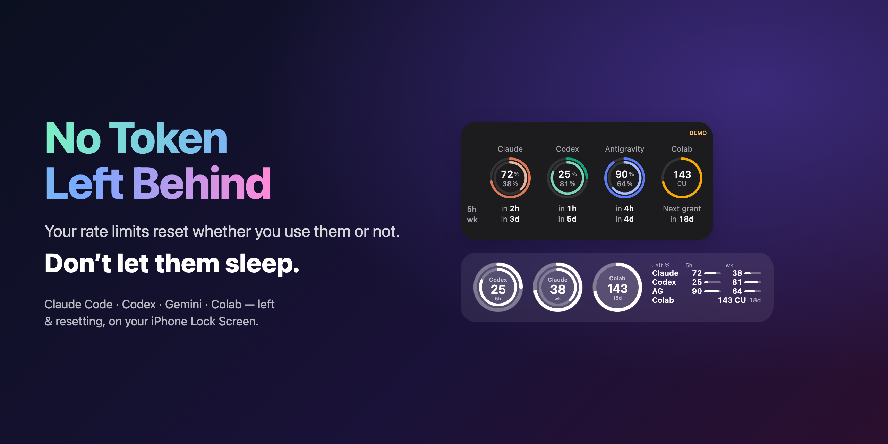
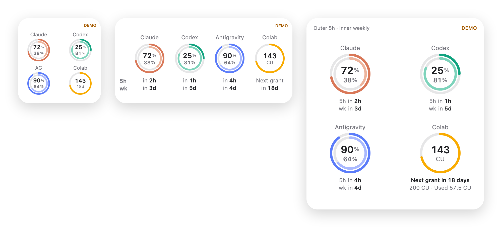
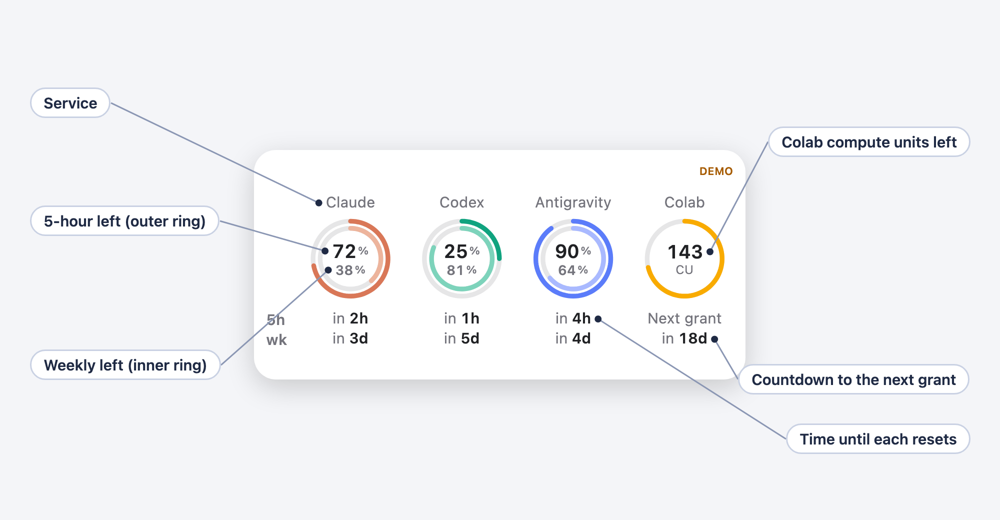
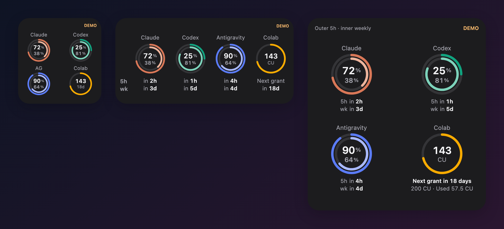
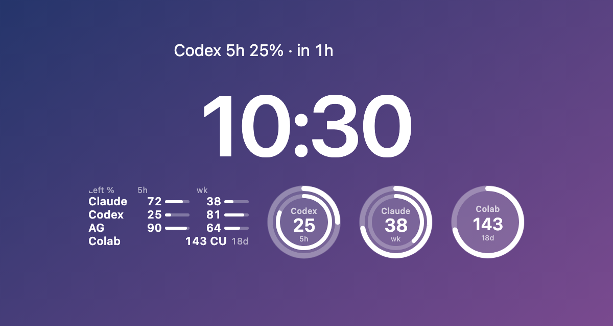
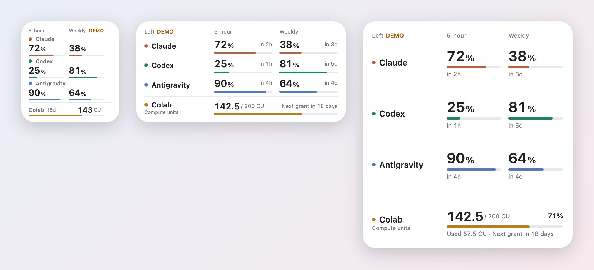
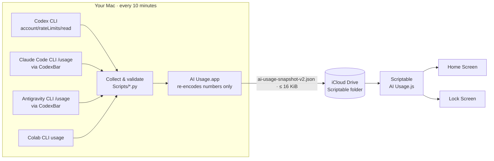

<div align="center">

**English** · [日本語](README.ja.md) · [简体中文](README.zh-CN.md) · [한국어](README.ko.md)



# No Token Left Behind

### Your rate limits reset whether you use them or not. Don’t let them sleep.

**Free, open-source iPhone widgets for Claude Code, OpenAI Codex, Gemini (Antigravity) and Google Colab usage limits.**<br>
See what’s left in your 5-hour and weekly windows — and when they reset — right on your Home Screen and Lock Screen.

[](https://github.com/tamutamu0/no-token-left-behind/stargazers)
[](https://github.com/tamutamu0/no-token-left-behind/actions/workflows/ci.yml)
[](LICENSE)


-supported-4285F4)


[**Quick start**](#quick-start) · [**Try the demo**](#quick-start) · [**How it works**](#how-it-works) · [**FAQ**](#faq)

</div>

---

## Contents

- [Why](#why)
- [Who it’s for](#who-its-for)
- [Highlights](#highlights)
- [Reading the widget](#reading-the-widget)
- [Gallery](#gallery)
- [Quick start](#quick-start)
- [Requirements](#requirements)
- [How it works](#how-it-works)
- [Configuration](#configuration)
- [Colab: “next grant in N days”](#colab-next-grant-in-n-days)
- [Everyday commands](#everyday-commands)
- [Privacy & security](#privacy--security)
- [FAQ](#faq)
- [Troubleshooting](#troubleshooting)
- [Roadmap](#roadmap)
- [Contributing](#contributing) · [License](#license)

## Why

Claude, Codex and Gemini give you a 5-hour window and a weekly allowance. Both reset on a timer — **whether you used them or not**. Every window that resets at 60% left is a feature you didn’t ship.

- 😴 **Idle quota is wasted quota.** “72% left · resets in 2h” means: start that refactor *now*.
- 🧱 **Don’t hit the wall mid-flow.** Find out you’re at 8% *before* you ask for the big migration.
- 🔀 **Juggling plans?** When Claude runs dry, one glance shows Codex still has 81%.
- 💳 **Colab units quietly run out.** See the balance and the days until the next grant, and burn them before they’re topped up.

No terminal, no dashboard, no Mac to open. Just glance at your Lock Screen.

<p align="center"></p>

## Who it’s for

| If you pay for… | The widget shows |
|---|---|
| **Claude Pro / Max** (Claude Code) | 5-hour session and weekly limits, with reset countdowns |
| **ChatGPT Plus / Pro** (Codex CLI) | 5-hour and weekly Codex limits |
| **Antigravity** (free or Google AI Pro / Ultra) | Gemini model quota, 5-hour and weekly |
| **Colab Pro / Pro+** (or a Google AI plan with Colab) | Compute units left, and days until the next grant |

Use any mix: a service you don’t connect simply shows “—”.

How it works, in one breath: your Mac already has the official CLIs signed in. Every 10 minutes the Mac app asks them — and only them — how much is left, and drops **just the numbers** into iCloud Drive. A tiny [Scriptable](https://scriptable.app/) script turns that file into widgets. **No server. No API keys. No browser cookies. No paid Apple Developer account.**

## Highlights

| | |
|---|---|
| 🧭 **Four services, one glance** | Claude and Codex (5-hour + weekly), Antigravity (Gemini 5-hour + weekly), Google Colab (compute units). |
| ⏱️ **When it comes back** | Every limit shows what is left *and* when it resets — “72% · in 2h”. |
| 💳 **Colab as a balance** | Compute units are a stock, not a window: shown apart, with the units left and a countdown to the next monthly grant that **learns the real grant day** from your history. |
| 🔒 **Lock Screen too** | Activity-style rings, a compact bar chart, or one line above the clock. The ring follows whichever service is closest to running out. |
| 🎨 **Two styles** | Rings (the default) or a compact table — pick per widget with `rings` / `table`, or set one for all. |
| 🌐 **Speaks your language** | Widget in English, 日本語, 简体中文 and 한국어 (follows the iPhone). Mac and iPhone apps in English and Japanese. |
| 🧪 **Honest numbers** | Values older than 15 minutes turn orange. A limit past its reset time says “Awaiting refresh” instead of pretending to be 100%. |
| 🩺 **Self-diagnosing** | `make doctor` checks every CLI, sign-in, the Mac app and the iCloud export, and tells you the exact fix. |
| 🛡️ **Numbers only** | Only official CLIs are asked. No cookies, no tokens, no browser automation. Your iCloud file holds percentages and timestamps — nothing else. |

## Reading the widget

<p align="center"></p>

- One **column** per service. The **outer ring** is the 5-hour window, the **inner ring** (a lighter tone) is the week.
- Inside the ring: the **big number** is the 5-hour % left, the **small one** the weekly % left.
- Below the ring: **when each one resets**. The `5h` / `wk` labels at the left edge name the two lines once for every column.
- A plan without a 5-hour window gets a **single ring** and one number — no dash, no empty ring.
- **Colab** is a balance, not a window: compute units left in the ring, and the days until the next grant below.
- A value more than 15 minutes old swaps the service name for its age (“18m ago”) in **orange**.

## Gallery

<table>
<tr>
<td width="50%"></td>
<td width="50%"></td>
</tr>
<tr>
<td align="center"><b>Dark mode</b> — follows the system appearance.</td>
<td align="center"><b>Lock Screen</b> — inline, rectangular, and rings (outer 5-hour, inner weekly).</td>
</tr>
<tr>
<td colspan="2"></td>
</tr>
<tr>
<td colspan="2" align="center"><b>Table style</b> — prefer numbers and bars? Put <code>table</code> in the widget’s Parameter.</td>
</tr>
</table>

| Widget | What it shows |
|---|---|
| **Small** | Four rings with the 5-hour and weekly % inside; Colab units and days to the next grant. |
| **Medium** | Adds the reset times (“in 2h”, “in 3d”) under every ring. |
| **Large** | Bigger rings with full reset times (“in 2h 0m”), Colab usage and the grant countdown. |
| **Lock · inline** | The window closest to running out, e.g. “Codex 5h 25% · in 1h”. |
| **Lock · rectangular** | Every service’s 5h/weekly % with thin bars, Colab at the bottom. |
| **Lock · circular** | Two rings for one service — automatically the one with the least left, or pin one with a parameter. |

## Quick start

> **Just want to see it?** Install Scriptable, add the script (step 3) and set the widget’s *Parameter* to `demo`. You get the full widget with sample data — no Mac needed.

**1. Build and install the Mac app** (about 2 minutes)

```bash
git clone https://github.com/tamutamu0/no-token-left-behind.git
cd no-token-left-behind
make install          # builds, signs locally, starts at login
```

**2. Connect the services you use** (skip any you don’t)

```bash
brew install --cask codexbar                      # helper that drives the Claude / Antigravity CLIs
python3 Scripts/install_statuslines.py            # also read Claude / Antigravity status lines (non-destructive)

# Google Colab: official CLI in the place the app looks for it, then authorize once
python3 -m venv "$HOME/Library/Application Support/AIUsage/ColabRuntime"
"$HOME/Library/Application Support/AIUsage/ColabRuntime/bin/pip" install google-colab-cli
"$HOME/Library/Application Support/AIUsage/ColabRuntime/bin/colab" --auth oauth2 usage
```

Codex needs nothing extra if `codex login` is done. Open the Mac app and press **Start collecting**.

**3. Put it on your iPhone**

```bash
make widget           # copies the script to iCloud Drive › Scriptable
```

1. In the Mac app, **Choose Scriptable folder** → pick **iCloud Drive › Scriptable**.
2. On the iPhone: touch and hold the Home Screen → **Edit** → **Add Widget** → **Scriptable** → pick a size → tap the widget → **Script: AI Usage**.
3. Lock Screen: touch and hold it → **Customize** → tap the widget area → **Scriptable**.

**4. Check everything**

```bash
make doctor
```

```text
Codex
  ✓ Codex CLI          /opt/homebrew/bin/codex · last collection succeeded
Claude
  ✓ Claude Code CLI    /opt/homebrew/bin/claude
  ✓ CodexBar           /opt/homebrew/bin/codexbar
  ✓ Collection         last collection succeeded
...
iPhone
  ✓ Usage file         updated 1 min ago

16 ok · 0 warning(s) · 0 problem(s)
```

The [setup guide](docs/en/setup.md) walks through every step with the details that trip people up.

## Requirements

| | |
|---|---|
| **iPhone** | iOS 16 or later for Lock Screen widgets · [Scriptable](https://apps.apple.com/app/scriptable/id1405459188) (free) · iCloud Drive |
| **Mac** | macOS 14 or later (Apple silicon or Intel) · Xcode 16 or later to build · iCloud Drive on the same Apple Account |
| **Codex** | Official [Codex CLI](https://github.com/openai/codex), signed in |
| **Claude** | Official [Claude Code](https://code.claude.com/) CLI, signed in and past first-run setup · [CodexBar](https://codexbar.app/) |
| **Antigravity** | Official Antigravity CLI, signed in · CodexBar |
| **Colab** | Official [google-colab-cli](https://github.com/googlecolab/google-colab-cli), authorized · a plan that includes compute units |

Use any subset. Services you don’t connect show “—”.

## How it works



1. The Mac app runs the collectors every 10 minutes. Each one asks a **signed-in official CLI** for its limits and nothing else.
2. Results are reduced to an allow-list — service, % used, reset time, balance, observation time — validated, and written atomically to iCloud Drive.
3. The Scriptable script validates the file again and draws the widgets. If a read fails, it keeps showing the last verified values with their real observation times.

More in [How it works](docs/en/how-it-works.md): the file format, freshness rules, and how Colab grants are detected.

## Configuration

### Widget parameter

Long-press the widget → **Edit Widget** → **Parameter**. Space-separated, all optional:

| Token | Effect |
|---|---|
| *(empty)* | Live data |
| `demo` | Sample data — try the widget without a Mac |
| `rings` · `table` | Home Screen style for this widget (default: rings) |
| `claude` · `codex` · `antigravity` · `colab` | Pin the Lock Screen ring / inline widget to one service (default: whichever has the least left) |
| `grant=4` | Treat the 4th of each month as Colab’s grant day for this widget |
| `lang=en` · `ja` · `zh` · `ko` | Force a language (default: the iPhone’s language, English otherwise) |

Examples: `colab` · `demo claude` · `colab grant=15 lang=en`

### Settings file

`iCloud Drive › Scriptable › ai-usage-settings.json` applies to every widget:

```json
{ "colabGrantDay": 4, "style": "rings" }
```

`style` is `"rings"` (default) or `"table"`; a `rings` / `table` token in a widget’s Parameter wins over it.

### Finding the CLIs

The collectors look for each CLI in `$AIUSAGE_<NAME>_PATH`, then your `PATH`, then the usual places (`/opt/homebrew/bin`, `/usr/local/bin`, `~/.local/bin`, `~/.npm-global/bin`, `~/.bun/bin`, `~/.volta/bin`, the CodexBar app). To pin one:

```bash
launchctl setenv AIUSAGE_CODEX_PATH /path/to/codex   # names: CODEX, CLAUDE, CODEXBAR, AGY, COLAB
```

## Colab: “next grant in N days”

The Colab CLI only reports the current balance — no grant date, no expiry. And Google AI plan grants are [known to arrive late](https://github.com/googlecolab/colabtools/issues/6127). So the widget works it out:

1. **Learned** — every observation is compared with the previous one; a rise of **10 CU or more is recorded as a grant** (`colab-grants.json`, kept on your Mac). Once one is seen, that day of the month is the grant day.
2. **Configured** — until then, `colabGrantDay` (or `grant=` in the parameter) is used. For Google AI plans, your Google One “next payment” date is a good guess.
3. **Waiting** — if the expected day passes without a grant being seen, the widget says **“Grant pending (due 4)”** rather than starting a fresh countdown.

Whether unused units expire at the next grant is not documented for Google AI plans (Colab Pro units expire after 90 days), so read it as “when the next top-up arrives”.

## Everyday commands

| Command | What it does |
|---|---|
| `make install` | Build the Mac app, sign it locally, register it as a login item, restart it |
| `make widget` | Copy the latest widget script to iCloud Drive › Scriptable |
| `make doctor` | Check CLIs, sign-ins, the Mac app and the export — with fixes |
| `make test` | Run the Python, JavaScript and Swift test suites |
| `make screenshots` | Re-render every README image from demo data, in four languages |
| `make help` | List everything |

## Privacy & security

- **Only official CLIs** are asked, using the sign-in you already made. Nothing reads passwords, cookies or OAuth tokens; there is no browser automation.
- **Only numbers leave the Mac**: service, source type, % used, reset time, balance and observation times. Anything else in a response is dropped before writing.
- **The widget has no network code.** It only reads the file in iCloud Drive.
- **No write paths**: there is no code path that starts a chat, runs a model, buys anything or resets a limit.
- Your iCloud copy lives in your Apple Account. Don’t choose a shared folder.

Details and limitations: [Security](docs/en/security.md) · Reporting a vulnerability: [SECURITY.md](SECURITY.md)

## FAQ

<details>
<summary><b>How do I check my Claude Code or Codex usage limit on my iPhone?</b></summary>

That’s exactly what this does. Set it up once (see [Quick start](#quick-start)), and your Home Screen and Lock Screen show the % left in the 5-hour and weekly windows, plus when each one resets.
</details>

<details>
<summary><b>Is it free?</b></summary>

Yes. It’s MIT-licensed. Scriptable is free, and you don’t need a paid Apple Developer account. You only need the AI plans you already pay for.
</details>

<details>
<summary><b>Does this use up my quota or tokens?</b></summary>

No. It only reads the remaining limits. Codex gets the `initialize` handshake and one `account/rateLimits/read`; Claude and Antigravity run their `/usage` command; Colab runs `usage`. No prompts, no model calls.
</details>

<details>
<summary><b>Why do I need a Mac?</b></summary>

The official CLIs — and your sign-ins to them — live on your computer. iOS can’t run them. The Mac does the asking; the iPhone only reads a small file.
</details>

<details>
<summary><b>Why is a number orange?</b></summary>

Either the limit is low (20% or less) or the value is more than 15 minutes old — usually because the Mac is asleep. Medium and large widgets show how old it is under the service name.
</details>

<details>
<summary><b>What does “Awaiting refresh” mean?</b></summary>

The reset time has passed but no new value has arrived yet. The widget won’t assume the limit is back to 100% until the next collection confirms it.
</details>

<details>
<summary><b>Can I use only some of the services?</b></summary>

Yes. Connect what you use; the rest show “—”. Colab is optional too.
</details>

<details>
<summary><b>Does it work on Intel Macs, or with tools not installed by Homebrew?</b></summary>

Yes. CLIs are found on your `PATH` and in the common install locations; `AIUSAGE_<NAME>_PATH` pins one if needed. `make doctor` shows what was found.
</details>

<details>
<summary><b>Which languages are supported?</b></summary>

The widget: English, Japanese, Simplified Chinese and Korean, following the iPhone (or `lang=` in the parameter). The Mac and iPhone apps: English and Japanese, following the system. Documentation: English and Japanese; this README in four languages.
</details>

<details>
<summary><b>Is this an official app from Anthropic, OpenAI or Google?</b></summary>

No. It is an independent open-source project that reads the official tools’ own output. Product names belong to their owners.
</details>

## Troubleshooting

Start with `make doctor` — it names the broken piece and the command that fixes it. Common cases:

| Symptom | Likely cause |
|---|---|
| Every value is “—” | Collecting hasn’t started, the Scriptable folder isn’t chosen, or iCloud hasn’t synced yet |
| One service is “—” | Its CLI isn’t signed in (Claude: finish the first-run setup) |
| Everything is orange | The Mac is asleep or the app isn’t running |
| Stopped after updating the app | Run `make install` again; the first time, re-choose the Scriptable folder |
| The widget doesn’t change | iOS decides when widgets redraw; tap the widget to refresh it |

More in the [setup guide](docs/en/setup.md#troubleshooting).

## Roadmap

- [ ] Signed, notarized Mac app builds on GitHub Releases (no Xcode needed)
- [ ] More services as their CLIs expose limits
- [ ] More app languages (the widget already has four)
- [ ] Optional notifications when a limit drops below a threshold

Ideas and pull requests are welcome.

## Contributing

Bug reports, translations and new services are all welcome. Please read [CONTRIBUTING.md](CONTRIBUTING.md) — it covers the layout of the code, running the tests and adding a language or a service. Include `python3 Scripts/doctor.py --json` in bug reports.

## Acknowledgements

[Scriptable](https://scriptable.app/) by Simon B. Støvring makes iPhone widgets possible without an App Store app. [CodexBar](https://codexbar.app/) drives the Claude and Antigravity CLIs. [XcodeGen](https://github.com/yonaskolb/XcodeGen) generates the Xcode project.

## Spread the word

If this saved even one 5-hour window from going to waste, a ⭐ helps the next person find it.

[](https://star-history.com/#tamutamu0/no-token-left-behind&Date)

## License

[MIT](LICENSE). Claude, Codex, Antigravity, Google Colab and related names are trademarks of their respective owners. This project is not affiliated with or endorsed by them.
