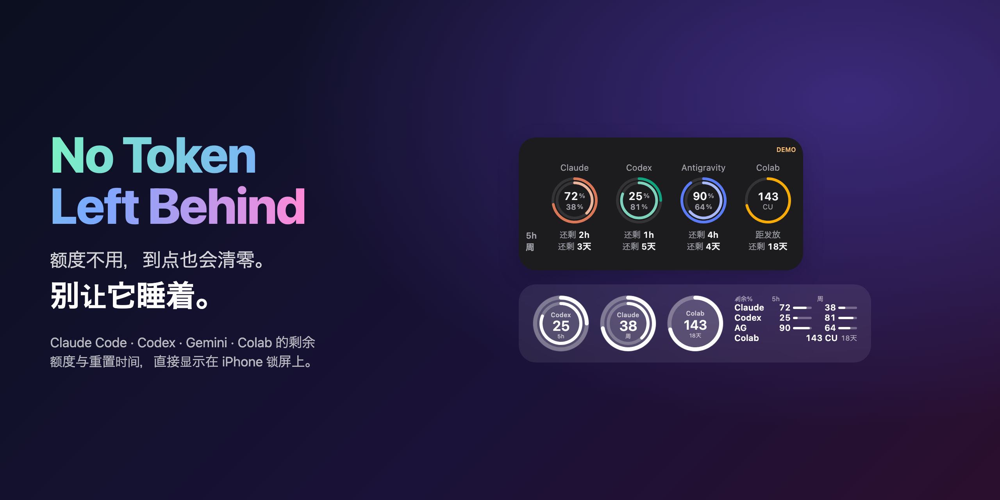
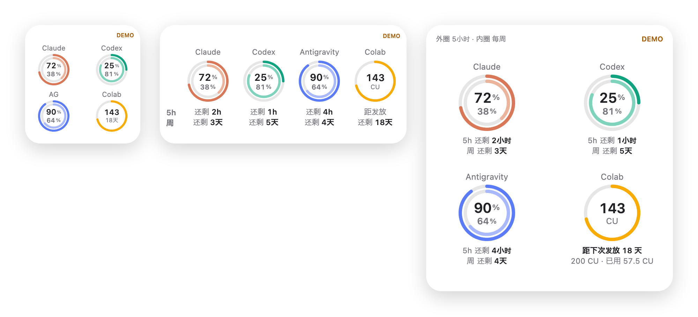
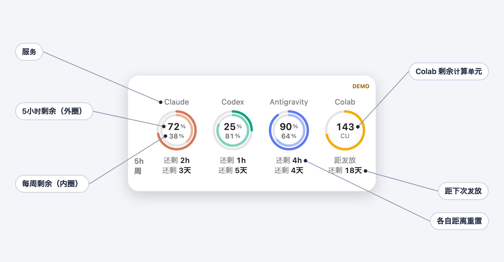
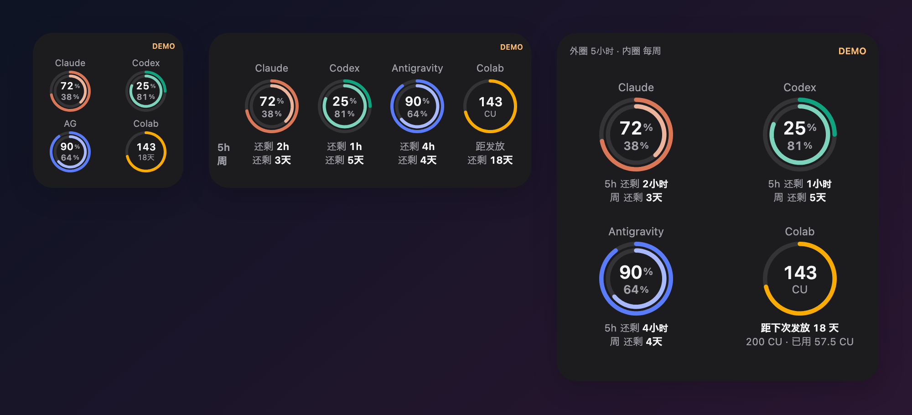
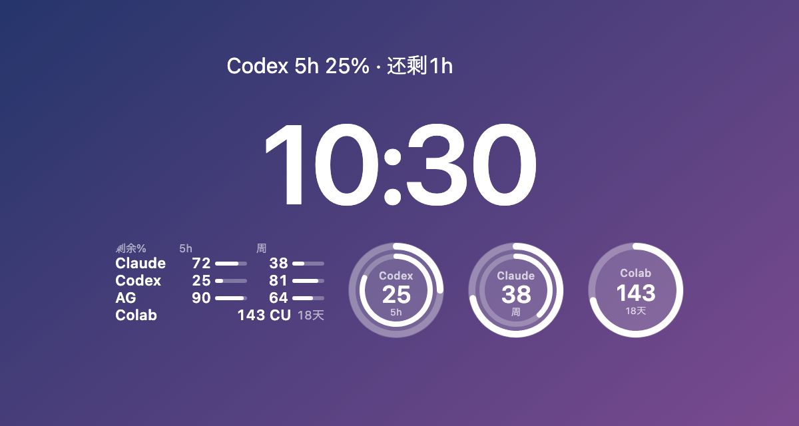
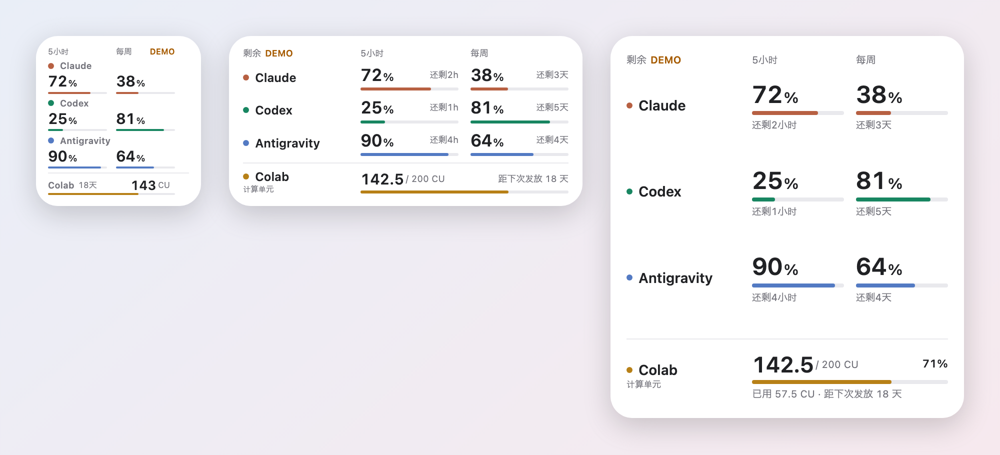
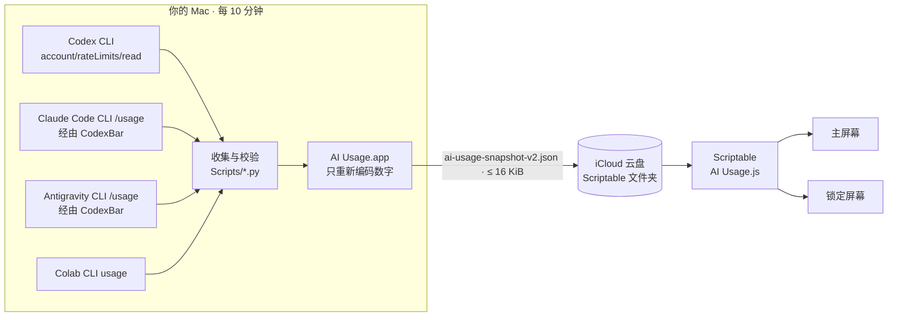

<div align="center">

[English](README.md) · [日本語](README.ja.md) · **简体中文** · [한국어](README.ko.md)



# No Token Left Behind

### 额度不用，到点也会清零。别让它睡着。

**免费开源的 iPhone 小组件，显示 Claude Code、OpenAI Codex、Gemini（Antigravity）和 Google Colab 的用量上限。**<br>
5 小时窗口和每周额度还剩多少、什么时候重置，在主屏幕和锁屏上一眼看清。

[](https://github.com/tamutamu0/no-token-left-behind/stargazers)
[](https://github.com/tamutamu0/no-token-left-behind/actions/workflows/ci.yml)
[](LICENSE)


-supported-4285F4)


[**快速开始**](#快速开始) · [**试用演示**](#快速开始) · [**工作原理**](#工作原理) · [**常见问题**](#常见问题)

</div>

> 详细文档目前提供 [English](docs/en/setup.md) 和 [日本語](docs/ja/setup.md) 两种语言。

---

## 目录

- [为什么需要它](#为什么需要它)
- [适合谁](#适合谁)
- [亮点](#亮点)
- [怎么看小组件](#怎么看小组件)
- [效果展示](#效果展示)
- [快速开始](#快速开始)
- [系统要求](#系统要求)
- [工作原理](#工作原理)
- [设置](#设置)
- [Colab：“距下次发放 N 天”](#colab距下次发放-n-天)
- [常用命令](#常用命令)
- [隐私与安全](#隐私与安全)
- [常见问题](#常见问题)
- [故障排查](#故障排查)
- [许可证](#许可证)

## 为什么需要它

Claude、Codex 和 Gemini 都有 5 小时窗口和每周额度，到点就会重置——**不管你用没用**。每一个剩着 60% 就被重置的窗口，都是一个本可以写完的功能。

- 😴 **闲置的额度就是浪费。** 看到“72% · 还剩2h”，那次重构现在就该开始。
- 🧱 **别在关键时刻撞墙。** 在让 AI 做大迁移*之前*，就知道只剩 8% 了。
- 🔀 **多个订阅轮着用？** Claude 用完了，一眼就能看到 Codex 还有 81%。
- 💳 **Colab 计算单元也别浪费。** 看到余额和距下次发放的天数，在补充之前把它用掉。

不用开终端、不用开网页面板、也不用开 Mac。瞄一眼锁屏就够了。

<p align="center"></p>

## 适合谁

| 如果你订阅了… | 小组件会显示 |
|---|---|
| **Claude Pro / Max**（Claude Code） | 5 小时会话额度和每周额度，以及重置倒计时 |
| **ChatGPT Plus / Pro**（Codex CLI） | Codex 的 5 小时和每周额度 |
| **Antigravity**（免费或 Google AI Pro / Ultra） | Gemini 模型额度，5 小时和每周 |
| **Colab Pro / Pro+**（或含 Colab 的 Google AI 套餐） | 剩余计算单元，以及距下次发放的天数 |

任意组合都可以，未连接的服务只会显示“—”。

一句话说明原理：你的 Mac 上已经登录了官方 CLI。Mac 应用每 10 分钟只向这些官方 CLI 询问剩余额度，并**只把数字**放进 iCloud 云盘，iPhone 上的 [Scriptable](https://scriptable.app/) 小脚本再把它变成小组件。**无需服务器、无需 API 密钥、不碰浏览器 Cookie、无需付费 Apple 开发者账号。**

## 亮点

| | |
|---|---|
| 🧭 **四项服务一屏看完** | Claude 和 Codex（5 小时 + 每周）、Antigravity（Gemini 的 5 小时 + 每周）、Google Colab（计算单元）。 |
| ⏱️ **什么时候恢复** | 每项额度都显示剩余量和重置时间，例如“72% · 还剩2h”。 |
| 💳 **Colab 按余额显示** | 计算单元是会被消耗的余额，而不是按时间恢复的额度：单独显示剩余 CU，以及距下次每月发放的天数，并**从历史记录中学习实际发放日**。 |
| 🔒 **锁定屏幕也支持** | 类似“健身记录”的双圆环、紧凑的条形表格，或时钟上方的一行文字。圆环会自动显示剩余最少的服务。 |
| 🎨 **两种样式** | 圆环（默认）或紧凑的表格。可以用 `rings` / `table` 为每个小组件单独选择，也可以统一设置。 |
| 🌐 **多语言** | 小组件支持英语、日语、简体中文和韩语（跟随 iPhone 语言）。Mac 与 iPhone 应用支持英语和日语。 |
| 🧪 **数字不掺水** | 超过 15 分钟的旧数据显示为橙色。已过重置时间的额度显示“等待刷新”，不会假装恢复到 100%。 |
| 🩺 **自我诊断** | `make doctor` 检查每个 CLI、登录状态、Mac 应用和 iCloud 导出，并给出具体的修复方法。 |
| 🛡️ **只有数字** | 只询问官方 CLI。不读取 Cookie、不提取令牌、不自动操作浏览器。iCloud 文件里只有百分比和时间。 |

## 怎么看小组件

<p align="center"></p>

- 每项服务一**列**。**外圈**是 5 小时窗口，**内圈**（较浅的色调）是每周额度。
- 圆环中的**大数字**是 5 小时剩余 %，**小数字**是每周剩余 %。
- 圆环下方是各自**距离重置的时间**。左侧的 `5h` / `周` 一次性说明所有列的两行含义。
- 没有 5 小时窗口的套餐只显示**一个圆环**和一个数字，不显示“—”或空圆环。
- **Colab** 是余额而不是按时间恢复的额度：圆环中是剩余 CU，下方是距下次发放的天数。
- 超过 15 分钟的旧数据会用**橙色**的经过时间（“18分前”）代替服务名称。

## 效果展示

<table>
<tr>
<td width="50%"></td>
<td width="50%"></td>
</tr>
<tr>
<td align="center"><b>深色模式</b> — 跟随系统外观。</td>
<td align="center"><b>锁定屏幕</b> — 单行、矩形和圆环（外圈 5 小时，内圈每周）。</td>
</tr>
<tr>
<td colspan="2"></td>
</tr>
<tr>
<td colspan="2" align="center"><b>表格样式</b> — 更喜欢数字和进度条？在小组件的 Parameter 中填写 <code>table</code>。</td>
</tr>
</table>

| 小组件 | 显示内容 |
|---|---|
| **小** | 四个圆环，内含 5 小时和每周剩余 %；Colab 剩余 CU 和距发放天数。 |
| **中** | 在每个圆环下方加上重置时间（“还剩2h”“还剩3天”）。 |
| **大** | 更大的圆环和完整的重置时间（“还剩2小时”），以及 Colab 已用量和发放倒计时。 |
| **锁屏 · 单行** | 最先用完的那项额度，例如“Codex 5h 25% · 还剩1h”。 |
| **锁屏 · 矩形** | 每项服务的 5h/每周剩余 % 与细进度条，底部是 Colab。 |
| **锁屏 · 圆形** | 用双圆环显示一项服务——默认自动选择剩余最少的，也可以用参数固定。 |

## 快速开始

> **只想先看看效果？** 安装 Scriptable，放好脚本（第 3 步），把小组件的 *Parameter* 设为 `demo`。无需 Mac 就能看到使用示例数据的完整小组件。

**1. 构建并安装 Mac 应用**（约 2 分钟）

```bash
git clone https://github.com/tamutamu0/no-token-left-behind.git
cd no-token-left-behind
make install          # 构建 → 本地签名 → 登录时自动启动
```

**2. 连接你使用的服务**（不用的可以跳过）

```bash
brew install --cask codexbar                      # 用于驱动 Claude / Antigravity CLI 的辅助工具
python3 Scripts/install_statuslines.py            # 同时读取 Claude / Antigravity 的 statusLine（不覆盖现有设置）

# Google Colab：把官方 CLI 安装到应用查找的位置，并完成一次授权
python3 -m venv "$HOME/Library/Application Support/AIUsage/ColabRuntime"
"$HOME/Library/Application Support/AIUsage/ColabRuntime/bin/pip" install google-colab-cli
"$HOME/Library/Application Support/AIUsage/ColabRuntime/bin/colab" --auth oauth2 usage
```

只要执行过 `codex login`，Codex 无需额外设置。打开 Mac 应用，点击 **Start collecting**。

**3. 放到 iPhone 上**

```bash
make widget           # 把脚本复制到 iCloud 云盘 › Scriptable
```

1. 在 Mac 应用中点击 **Choose Scriptable folder**，选择 **iCloud 云盘 › Scriptable**。
2. 在 iPhone 上长按主屏幕 → **编辑** → **添加小组件** → **Scriptable** → 选择尺寸 → 轻点小组件 → **Script: AI Usage**。
3. 锁定屏幕：长按 → **自定** → 轻点小组件区域 → **Scriptable**。

**4. 全面检查**

```bash
make doctor
```

## 系统要求

| | |
|---|---|
| **iPhone** | 锁屏小组件需 iOS 16 及以上 · [Scriptable](https://apps.apple.com/app/scriptable/id1405459188)（免费）· iCloud 云盘 |
| **Mac** | macOS 14 及以上（Apple 芯片或 Intel）· 用于构建的 Xcode 16 及以上 · 同一 Apple 账户的 iCloud 云盘 |
| **Codex** | 已登录的官方 [Codex CLI](https://github.com/openai/codex) |
| **Claude** | 已登录并完成首次设置的官方 [Claude Code](https://code.claude.com/) CLI · [CodexBar](https://codexbar.app/) |
| **Antigravity** | 已登录的官方 Antigravity CLI · CodexBar |
| **Colab** | 已授权的官方 [google-colab-cli](https://github.com/googlecolab/google-colab-cli) · 包含计算单元的套餐 |

可以只使用其中一部分服务，未连接的服务显示“—”。

## 工作原理



1. Mac 应用每 10 分钟运行一次收集程序。每个程序只向**已登录的官方 CLI** 询问额度。
2. 结果被精简为白名单字段（服务、已用百分比、重置时间、余额、观测时间），经过校验后原子化写入 iCloud 云盘。
3. Scriptable 脚本再次校验后绘制小组件。读取失败时，会继续显示上次校验通过的数据及其真实观测时间。

## 设置

### 小组件参数

长按小组件 → **编辑小组件** → **Parameter**。用空格分隔，全部可选：

| 写法 | 效果 |
|---|---|
| （留空） | 实时数据 |
| `demo` | 示例数据——无需 Mac 即可试用 |
| `rings` · `table` | 此小组件的主屏幕样式（默认：圆环） |
| `claude` · `codex` · `antigravity` · `colab` | 固定锁屏圆环 / 单行显示的服务（默认：剩余最少的） |
| `grant=4` | 此小组件把每月 4 日视为 Colab 的发放日 |
| `lang=en` · `ja` · `zh` · `ko` | 固定显示语言（默认跟随 iPhone，不支持时为英语） |

### 设置文件

`iCloud 云盘 › Scriptable › ai-usage-settings.json` 对所有小组件生效：

```json
{ "colabGrantDay": 4, "style": "rings" }
```

`style` 可为 `"rings"`（默认）或 `"table"`；小组件 Parameter 中的 `rings` / `table` 优先。

### CLI 的查找位置

依次查找 `$AIUSAGE_<名称>_PATH` → `PATH` → 常见位置（`/opt/homebrew/bin`、`/usr/local/bin`、`~/.local/bin`、`~/.npm-global/bin`、`~/.bun/bin`、`~/.volta/bin`、CodexBar 应用内）。如需固定：

```bash
launchctl setenv AIUSAGE_CODEX_PATH /path/to/codex   # 名称：CODEX、CLAUDE、CODEXBAR、AGY、COLAB
```

## Colab：“距下次发放 N 天”

Colab CLI 只返回当前余额，不提供发放日期或过期时间，而且 Google AI 套餐的发放[有延迟的报告](https://github.com/googlecolab/colabtools/issues/6127)。因此小组件这样判断：

1. **学习**：每次观测都与上一次比较，**增加 10 CU 及以上即记录为一次发放**（`colab-grants.json`，保存在 Mac 上）。观测到一次后，就把那一天作为每月的发放日。
2. **设置**：在此之前使用 `colabGrantDay`（或参数中的 `grant=`）。对于 Google AI 套餐，Google One 的“下次付款”日期可作参考。
3. **等待**：预计日期已过但仍未观测到发放时，显示“**等待发放（预计4日）**”，而不是开始新的倒计时。

## 常用命令

| 命令 | 作用 |
|---|---|
| `make install` | 构建 Mac 应用、本地签名、注册为登录项并重启 |
| `make widget` | 把最新的小组件脚本复制到 iCloud 云盘 › Scriptable |
| `make doctor` | 检查 CLI、登录、Mac 应用和导出，并给出修复方法 |
| `make test` | 运行 Python、JavaScript 和 Swift 测试 |
| `make screenshots` | 用示例数据重新生成四种语言的 README 图片 |

## 隐私与安全

- 只询问你已登录的**官方 CLI**。不读取密码、Cookie 或 OAuth 令牌，也不自动操作浏览器。
- **离开 Mac 的只有数字**：服务、来源类型、已用百分比、重置时间、余额和观测时间。
- **小组件没有任何网络代码**，只读取 iCloud 云盘中的文件。
- 没有任何发起对话、运行模型、购买或重置额度的代码路径。

详情请参阅 [Security（英文）](docs/en/security.md) · 漏洞报告：[SECURITY.md](SECURITY.md)

## 常见问题

<details>
<summary><b>会消耗我的额度或令牌吗？</b></summary>

不会。它只读取剩余额度：Codex 只有 `initialize` 握手和一次 `account/rateLimits/read`；Claude 和 Antigravity 运行 `/usage`；Colab 运行 `usage`。不发送提示词，不调用模型。
</details>

<details>
<summary><b>为什么需要 Mac？</b></summary>

官方 CLI 和你的登录信息都在电脑上，iOS 无法运行它们。查询由 Mac 完成，iPhone 只读取一个小文件。
</details>

<details>
<summary><b>为什么数字是橙色的？</b></summary>

要么剩余很少（20% 及以下），要么数据已超过 15 分钟——通常是 Mac 进入了睡眠。
</details>

<details>
<summary><b>这是 Anthropic、OpenAI 或 Google 的官方应用吗？</b></summary>

不是。这是一个读取官方工具自身输出的独立开源项目。产品名称归各自所有者所有。
</details>

## 故障排查

先运行 `make doctor`——它会指出出问题的环节以及修复命令。

| 现象 | 可能原因 |
|---|---|
| 全部显示“—” | 尚未开始收集、未选择 Scriptable 文件夹，或 iCloud 尚未同步 |
| 某项服务显示“—” | 该 CLI 未登录（Claude 还需完成首次设置） |
| 全部为橙色 | Mac 处于睡眠或应用未运行 |
| 更新应用后停止 | 重新运行 `make install`；首次可能需要重新选择 Scriptable 文件夹 |

## 支持一下

如果它帮你保住了哪怕一个 5 小时窗口，点个 ⭐ 能让更多人发现它。

[](https://star-history.com/#tamutamu0/no-token-left-behind&Date)

## 许可证

[MIT](LICENSE)。Claude、Codex、Antigravity、Google Colab 等名称为各自所有者的商标。本项目与上述公司无隶属或认可关系。
