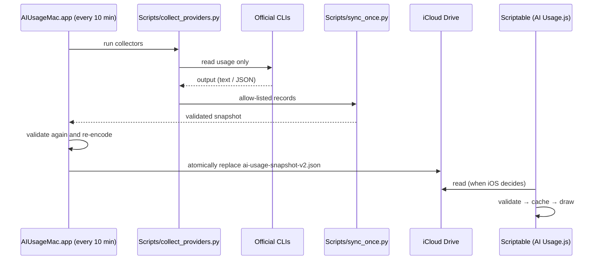

**English** · [日本語](../ja/how-it-works.md)

# How it works

## Data flow



- The four services are queried in parallel, each with its own timeout. One failure doesn't hold up the others.
- A failed service keeps its previous value **and that value's observation time**. Syncing again never makes an old reading look new.
- An older observation never overwrites a newer one.

## Sources

| Service | How | What is kept |
|---|---|---|
| Codex | Sends only `initialize` and `account/rateLimits/read` to the official Codex CLI app-server | 5-hour and weekly used % plus reset times |
| Claude | Official Claude Code CLI `/usage` through CodexBar's CLI adapter, plus `rate_limits` from the official statusLine | `Current session` → 5-hour, `Current week (all models)` → weekly |
| Antigravity | Official Antigravity CLI `/usage` through CodexBar, plus statusLine `quota.gemini-5h` / `quota.gemini-weekly` | Gemini model quota, 5-hour and weekly |
| Colab | Official `colab --auth oauth2 usage` | Current balance, burn rate, active runtimes |

CodexBar runs with a dedicated temporary config that pins it to the CLI source. It never falls back to cookies or the browser, and any answer whose source isn't the CLI is discarded.

Values in an unknown shape are never guessed into a 5-hour or weekly slot. A window that can't be read is treated as "not available": the widget leaves the cell empty if the plan simply has no such window, and shows "—" only when reading failed.

CLIs are located with `find_cli` in `Scripts/usage_io.py` (`$AIUSAGE_<NAME>_PATH` → `PATH` → common locations).

## The sync file

`ai-usage-snapshot-v2.json` (at most 16 KiB):

```json
{
  "version": 1,
  "generatedAt": 1900000000,
  "isDemo": false,
  "records": [
    { "service": "claude", "source": "claudeCli", "observedAt": 1899999990,
      "fiveHour": { "usedPercent": 28, "resetsAt": 1900007200 },
      "weekly":   { "usedPercent": 62, "resetsAt": 1900259200 } },
    { "service": "codex", "source": "codexAppServer", "observedAt": 1899999991,
      "weekly":   { "usedPercent": 19, "resetsAt": 1900432000 } },
    { "service": "colab", "source": "colabCli", "observedAt": 1899999992,
      "balance": 142.5,
      "balanceAllocation": { "total": 200, "basis": "confirmedInitialGrant" },
      "lastGrantAt": 1899500000 }
  ]
}
```

| Field | Meaning |
|---|---|
| `service` | `claude`, `codex`, `antigravity` or `colab` |
| `source` | Where the value came from (a fixed list, including `manual` and `demo`) |
| `observedAt` | When the value was actually observed (Unix seconds) |
| `fiveHour` / `weekly` | Used percent (0–100) and reset time. Omitted when the plan has no such window |
| `balance` | Colab compute units left |
| `balanceAllocation` | A confirmed total (see [below](#colab-total-and-percentage)) |
| `lastGrantAt` | The last time a Colab grant was observed (see [below](#colab-grant-detection)) |

Both the Mac (Python and Swift) and Scriptable check types, ranges and combinations. For example, they reject Colab with a 5-hour window, an observation time far in the future, or the same service listed twice. Fields that aren't on the list are dropped when the snapshot is re-encoded.

**Forward compatibility:** a record for a service the reader doesn't know is skipped, not fatal. An older widget keeps working when a newer Mac app adds a service.

## Freshness

| State | Display |
|---|---|
| Observed within 15 minutes | Normal colors |
| Older than 15 minutes | Orange. Medium and large also show the age under the name |
| Reset time has passed | Not assumed to be 100%. Shows "Awaiting refresh" |
| 20% or less left | Orange |
| iCloud read fails | The last validated values from Scriptable's own cache, with their real observation time |

The widget asks to redraw after 10 minutes, but iOS decides when it actually does.

## Home Screen styles

| Style | Layout |
|---|---|
| Rings (default) | One column per service: outer ring = 5-hour, inner ring = weekly (a lighter tone of the brand color), both remaining percentages inside, reset times below. A stale column shows its age in place of the name |
| Table | Services as rows, 5-hour and weekly columns with numbers and bars, Colab under a divider |

The style comes from a `rings` / `table` token in the Parameter, then `style` in `ai-usage-settings.json`, then the default (rings). The rings are drawn as an image with a neutral gray track; the numbers are ordinary text laid over it, so they follow light and dark mode.

## Lock Screen widgets

| Family | Content |
|---|---|
| Inline | The window closest to running out, e.g. "Codex 5h 25% · in 1h" |
| Rectangular | One line per service: 5h / weekly % left with mini bars. Colab on the bottom row |
| Circular | Two concentric rings for one service: outer = 5-hour, inner = weekly. Colab is a single ring showing the balance and days to the next grant |

When the Parameter doesn't name a service, the circular and inline widgets pick the **most constrained** service: the lowest percentage left in any window. iOS draws the Lock Screen in one tint, so the rings use only white at different opacities.

## Languages

The widget has its own string table (`I18N` in `AI Usage.js`) for English, Japanese, Simplified Chinese and Korean. It picks the language from `Device.language()`, or from a `lang=` token in the Parameter, and falls back to English. The Mac and iOS apps use String Catalogs (`Resources/Localizable.xcstrings`, `InfoPlist.xcstrings`) with English as the development language and a Japanese translation.

## Colab grant detection

The official CLI reports no grant history and no schedule. So grants are found in the readings the app already takes every 10 minutes:

1. Each reading appends balance, burn rate, runtimes and time to `colab-history.json` on the Mac. It keeps 90 days and never goes to iCloud.
2. If the balance went up by **10 CU or more** since the previous reading, a grant goes into `colab-grants.json`: the times before and after, and the balance before and after. That file keeps the latest 36 events, beyond 90 days.
3. The time of the newest grant goes into the snapshot as `lastGrantAt`.

How the widget picks the grant day:

1. If `lastGrantAt` exists, its day of the month is the grant day.
2. Otherwise, `colabGrantDay` from the settings file, or `grant=` in the Parameter.
3. If the expected day has passed with no new grant seen, it shows "Grant pending (due 4)" instead of starting a new countdown. Twenty days after the expected day, it moves on to the next cycle.

Increases aren't classified automatically as grant, rollover or expiry. Whether the balance went back to 200 or had 200 added to it can be checked from the before and after values in `colab-grants.json`.

## Colab total and percentage

The CLI only gives the current balance. A percentage such as "71% of 200 CU" is shown only when you have confirmed the total. It lives in `~/Library/Application Support/AIUsage/colab-allocation.json`:

```json
{
  "version": 1,
  "basis": "confirmedInitialGrant",
  "total": 200,
  "confirmedAt": 1900000000,
  "lastObservedAt": 1900000000,
  "lastBalance": 200,
  "valid": true
}
```

This basis counts usage since the first grant. It turns itself off, and the percentage disappears, when any of the following happens. It never quietly resets to 200.

- The balance goes above the total or rises from the previous reading (a new grant or a purchase).
- The balance changes across a gap in readings.
- 30 days pass after confirmation.

## The native app

The native app (`iOS/`, `Widget/`) skips iCloud. It connects straight to the Mac app over TLS-PSK. It uses the same data format and validation (`Shared/UsageModels.swift`). See [Development](development.md#native-app).
