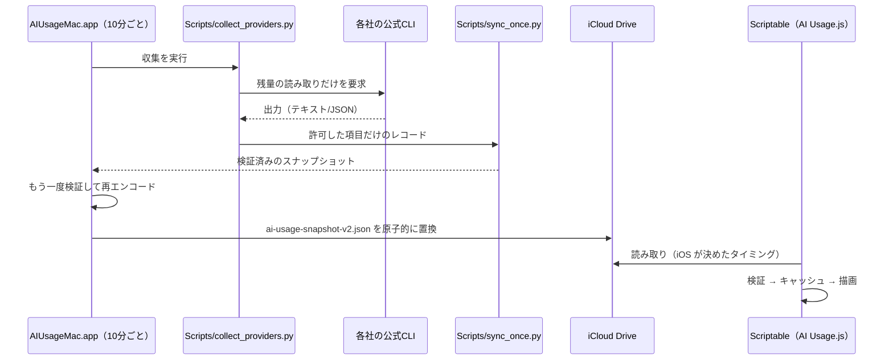

[English](../en/how-it-works.md) · **日本語**

# 仕組み

## データの流れ



- 4 サービスは並行して照会し、それぞれ制限時間を設けています。1 つが失敗しても他は更新されます。
- 失敗したサービスは、前回の値と**その観測時刻**を保ちます。同期し直しても観測時刻は新しくなりません。
- 古い観測で新しい値を上書きしません。

## 取得元

| サービス | 取得方法 | 取り込む値 |
|---|---|---|
| Codex | 公式 Codex CLI の app-server に `initialize` と `account/rateLimits/read` だけを送る | 5 時間・週間の使用率と回復時刻 |
| Claude | 公式 Claude Code CLI の `/usage` を CodexBar の CLI アダプター経由で照会。公式 statusLine の `rate_limits` も取り込む | `Current session` を 5 時間、`Current week (all models)` を週間 |
| Antigravity | 公式 Antigravity CLI の `/usage` を CodexBar 経由で照会。statusLine の `quota.gemini-5h` / `quota.gemini-weekly` も取り込む | Gemini モデル枠の 5 時間・週間 |
| Colab | 公式 `colab --auth oauth2 usage` | 現在の残高、消費ペース、稼働中のランタイム数 |

CodexBar は専用の一時設定で CLI だけを使うよう固定し、Cookie やブラウザ経由の取得に切り替えることはありません。取得元が CLI でない応答は捨てます。

知らない形式の値を、推測で 5 時間枠などに当てはめることはしません。取れない枠は「取得なし」として扱います。プランにその枠がないだけならセルを空けます。「—」を出すのは取得に失敗したときだけです。

CLI の場所は `Scripts/usage_io.py` の `find_cli` で探します（`$AIUSAGE_<名前>_PATH` → `PATH` → よく使われる場所）。

## 同期ファイル

`ai-usage-snapshot-v2.json`（最大 16 KiB）の例：

```json
{
  "version": 1,
  "generatedAt": 1900000000,
  "isDemo": false,
  "records": [
    { "service": "claude", "source": "claudeCli", "observedAt": 1899999990,
      "fiveHour": { "usedPercent": 28, "resetsAt": 1900007200 },
      "weekly":   { "usedPercent": 62, "resetsAt": 1900259200 } },
    { "service": "codex", "source": "codexAppServer", "observedAt": 1899999991,
      "weekly":   { "usedPercent": 19, "resetsAt": 1900432000 } },
    { "service": "colab", "source": "colabCli", "observedAt": 1899999992,
      "balance": 142.5,
      "balanceAllocation": { "total": 200, "basis": "confirmedInitialGrant" },
      "lastGrantAt": 1899500000 }
  ]
}
```

| 項目 | 意味 |
|---|---|
| `service` | `claude` / `codex` / `antigravity` / `colab` のいずれか |
| `source` | 取得元の種類（`manual`・`demo` を含む固定の一覧） |
| `observedAt` | その値を実際に観測した時刻（UNIX 秒） |
| `fiveHour` / `weekly` | 使用率（0〜100）と回復時刻。プランにその枠がなければ省略 |
| `balance` | Colab の残り計算ユニット |
| `balanceAllocation` | 確認済みの総量（[後述](#colab-の総量と割合)） |
| `lastGrantAt` | Colab の付与を最後に観測した時刻（[後述](#colab-の付与の検出)） |

Mac（Python と Swift）と Scriptable の両方で、型・範囲・組み合わせを検証します。たとえば Colab に 5 時間枠が付いている、観測時刻が未来すぎる、同じサービスが 2 回ある、といったファイルは採用しません。一覧にない項目は再エンコードの時点で捨てます。

**前方互換性**：読み手の知らないサービスのレコードは、エラーにせず読み飛ばします。新しい Mac アプリがサービスを追加しても、古いウィジェットはそのまま動きます。

## 鮮度の扱い

| 状態 | 表示 |
|---|---|
| 観測から 15 分以内 | 通常の色 |
| 15 分より古い | オレンジ。中・大サイズは名前の下に経過時間 |
| 回復時刻を過ぎた | 100% と決めつけず「再取得待ち」 |
| 残り 20% 以下 | オレンジ |
| iCloud の読み込みに失敗 | Scriptable 内のキャッシュ（前回の検証済みの値）を、本当の観測時刻つきで表示 |

ウィジェットは 10 分後の再描画を要求しますが、実際のタイミングは iOS が決めます。

## ロック画面ウィジェット

| 種類 | 表示内容 |
|---|---|
| 1 行 | いちばん先に尽きそうな枠。例「Codex 5h 25% · あと1h」 |
| 長方形 | サービスごとに 1 行。5h/週の残り % と細いバー。最下段に Colab |
| 円形 | 1 サービスを二重のリングで（外側が 5 時間、内側が週間）。Colab は 1 本のリングで残高と付与までの日数 |

Parameter でサービスを指定しなければ、円形と 1 行は**いちばん余裕のない**サービス（どれかの枠の残り % が最も低いもの）を選びます。iOS はロック画面を単色にするので、リングは白と不透明度だけで描きます。

## 多言語対応

ウィジェットは `AI Usage.js` 内の文字列表 `I18N` を持ち、英語・日本語・中国語（簡体字）・韓国語に対応しています。言語は `Device.language()`、または Parameter の `lang=` から決め、対応外なら英語にします。Mac・iOS アプリは String Catalog（`Resources/Localizable.xcstrings`、`InfoPlist.xcstrings`）を使い、開発言語を英語、翻訳を日本語としています。

## Colab の付与の検出

公式 CLI は、付与の履歴も予定も返しません。そこで、すでに 10 分ごとに行っている照会の結果から付与を見つけます。

1. 照会のたびに、残高・消費ペース・稼働数・観測時刻を Mac 内の `colab-history.json` に追記します（90 日分。iCloud には出しません）。
2. 直前の観測より残高が **10 CU 以上増えていたら**、`colab-grants.json` に付与として記録します（直前と直後の観測時刻、増減前後の残高）。このファイルは 90 日を過ぎても消さず、最新の 36 件を残します。
3. 最新の付与の観測時刻を、`lastGrantAt` として同期ファイルに入れます。

ウィジェット側の付与日の決め方：

1. `lastGrantAt` があれば、その日（毎月何日か）を付与日とする
2. なければ設定ファイルの `colabGrantDay`、またはウィジェットの Parameter の `grant=`
3. 予定日を過ぎても新しい付与を観測していなければ「付与待ち（予定4日）」と表示する（予定日から 20 日を過ぎたら次の周期として扱う）

増え方を「付与」「繰り越し」「失効」に自動で分類することはしません。残高が 200 に戻ったのか、前の残りに 200 が足されたのかは、`colab-grants.json` の前後の値で確認できます。

## Colab の総量と割合

CLI からは現在の残高しか取れません。そのため「200 CU のうち 71%」のような割合は、利用者が総量を確認した場合だけ表示します。Mac の `~/Library/Application Support/AIUsage/colab-allocation.json` に次の形で置きます。

```json
{
  "version": 1,
  "basis": "confirmedInitialGrant",
  "total": 200,
  "confirmedAt": 1900000000,
  "lastObservedAt": 1900000000,
  "lastBalance": 200,
  "valid": true
}
```

この基準は「最初の付与からの消費」を数えるためのものです。次のどれかが起きると自動で無効になり、割合を表示しなくなります。勝手に 200 へ戻すことはしません。

- 残高が総量を超えた、または前回より増えた（新しい付与・購入）
- 観測の間が空いた状態で残高が変わった
- 確認から 30 日を過ぎた

## ネイティブ版との違い

ネイティブ版（`iOS/`・`Widget/`）は iCloud を使わず、Mac のアプリに TLS-PSK で直接つなぎます。データの形式と検証は共通です（`Shared/UsageModels.swift`）。[開発メモ](development.md#ネイティブ版)を参照してください。
